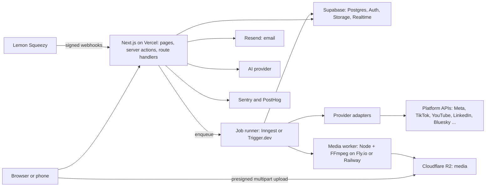
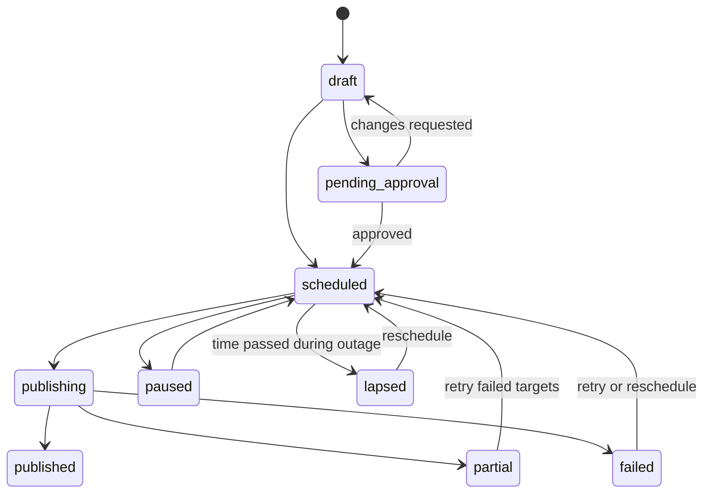

# Backend guide — AgentiqSocial

Architecture, data, security, and background work for everything that runs on the server. UI work is in `docs/FRONTEND.md`. Rules are in `CLAUDE.md`. Recipes are in `.claude/skills/scheduler-dev/SKILL.md`. Test cases are in `docs/TEST.md`.

Last updated: 2026-10-23.

**Contents**

1. Architecture overview
2. What runs where
3. Environments and configuration
4. Data model
5. Multi-tenancy and row-level security
6. Authentication, sessions and access tokens
7. API design
8. Publishing engine
9. Provider adapters
10. Media pipeline
11. Billing (Lemon Squeezy)
12. Analytics and reports
13. Inbox, Google Business Profile and later modules
14. Notifications and email
15. Realtime
16. AI services
17. Security
18. Reliability and operations
19. Observability
20. Performance and scaling
21. Code organisation
22. Build order by phase
23. Open decisions

Platform limits, approval rules and vendor features change. Anything marked **verify** must be checked against the vendor's current documentation before you rely on it.

---

## 1. Architecture overview



**Principles**

1. **The database is the source of truth.** State lives in Postgres. Queues carry IDs, not data.
2. **Publishing never runs inside a web request.** Requests enqueue; workers publish.
3. **Every external effect is idempotent.** Publishing, payments, emails, webhooks, uploads.
4. **Tenant isolation is enforced by the database** (RLS), then again in code.
5. **Platform-specific code lives in one place** (`src/providers/<platform>`).
6. **Fail loudly and visibly.** Every failure is recorded, shown to the user in plain words, and has a retry path.

---

## 2. What runs where

| Concern | Where | Why |
|---|---|---|
| Page rendering, UI mutations | Next.js server components and **server actions** | Close to the UI, typed, cookie auth |
| Webhooks, OAuth callbacks, public REST API, MCP | Next.js **route handlers** | Need raw bodies, custom headers, non-browser clients |
| Tenant rules and data integrity | **Postgres** (RLS, constraints, triggers, functions) | Cannot be bypassed by a code bug |
| Scheduled publishing, retries, metric fetching, emails, exports | **Job runner** (Inngest, or Trigger.dev) | Durable, retried, delayed |
| Finding due posts every minute | Scheduled function (job-runner cron, or Supabase `pg_cron`) | Selects due targets and enqueues them |
| Video probing, thumbnails, reframing, transcoding | **Media worker** (Node + FFmpeg) | Long-running and CPU-heavy; not for serverless functions |
| File storage | **R2** (media), Supabase Storage (small public assets such as avatars) | R2 has no egress fees; large multipart uploads |
| Live status and presence | **Supabase Realtime** | Built in; authorised by RLS |

Choose **server action** for a button or form in our own UI. Choose **route handler** for anything called by another system. Never put business rules only in a route; put them in a service function that both can call.

---

## 3. Environments and configuration

| Environment | Purpose | Data |
|---|---|---|
| Local | `supabase start`, mock providers | Seed data |
| Preview | One per pull request | Throwaway or shared dev project |
| Staging | Mirrors production config | Test data, Lemon Squeezy test mode, platform test apps |
| Production | Customers | Real data; backups on; alerts on |

Staging and production share **nothing**: different Supabase projects, R2 buckets, encryption keys, OAuth apps, webhook secrets and email domains.

**Environment variables.** Validate all of them with zod at boot, so a missing value fails immediately with a clear message. Only `NEXT_PUBLIC_*` values may reach the browser.

| Variable | Scope | Used for |
|---|---|---|
| `NEXT_PUBLIC_SUPABASE_URL`, `NEXT_PUBLIC_SUPABASE_PUBLISHABLE_KEY` | Public | The publishable key (or legacy anon key) is public by design; RLS and grants protect data |
| `SUPABASE_SECRET_KEY` | Server only | Secret key (or legacy service_role key): admin client in jobs and webhooks. Never import from client code |
| `DATABASE_URL` | Server only | Direct and pooled Postgres connections (migrations, jobs) |
| `ENCRYPTION_KEYS` (key id → key) and `ENCRYPTION_ACTIVE_KEY_ID` | Server only | Encrypting platform tokens |
| `R2_ACCOUNT_ID`, `R2_ACCESS_KEY_ID`, `R2_SECRET_ACCESS_KEY`, `R2_BUCKET` | Server only | Presigned uploads and downloads |
| `LEMONSQUEEZY_API_KEY`, `LEMONSQUEEZY_STORE_ID`, `LEMONSQUEEZY_WEBHOOK_SECRET` | Server only | Checkout creation and webhook verification |
| `INNGEST_EVENT_KEY`, `INNGEST_SIGNING_KEY` (or Trigger.dev equivalents) | Server only | Job runner |
| `RESEND_API_KEY` | Server only | Email |
| `<PLATFORM>_CLIENT_ID`, `<PLATFORM>_CLIENT_SECRET` | Server only | OAuth apps, one pair per platform |
| `SENTRY_DSN`, `NEXT_PUBLIC_POSTHOG_KEY` | Mixed | Errors and product analytics |
| `AI_API_KEY` | Server only | Caption generation |
| `MEDIA_WORKER_URL`, `MEDIA_WORKER_SECRET` | Server only | Calling the media worker |

Secrets live in the host's secret store, never in the repository. Rotation steps are rehearsed (`TEST.md` TOK-21).

---

## 4. Data model

**Conventions**

- UUID primary keys (`gen_random_uuid()`). Every timestamp is `timestamptz` in UTC.
- Statuses are `text` with `check` constraints (easier to migrate than Postgres enums).
- Every tenant table has `workspace_id`, an index on it, and RLS (section 5).
- `created_at` on every table; `updated_at` where rows change. A `version int` column on rows that users edit concurrently (posts, drafts, comments) for optimistic locking.
- Soft delete (`deleted_at`) only where users can undo. Everything else is deleted for real, with cascades.
- Migrations are forward-only in production. Expand, then migrate, then contract.

### 4.1 Tables by domain

**Identity and access:** `profiles` (id = auth user id, display_name, persona, timezone, locale, use_24h_time, avatar_url), `workspaces`, `workspace_members`, `invites` (token stored as a hash), `member_permissions`.

**Billing:** `subscriptions`, `webhook_events`, `usage_counters`, `idempotency_keys`.

**Social accounts:** `social_accounts` (tokens encrypted), plus a `social_accounts_public` view without token columns.

**Media:** `media_folders`, `media_assets`, `upload_sessions`.

**Posts:** `posts`, `post_media`, `post_targets`, `preflight_reports`, `queue_slots`, `post_versions`.

**Collaboration:** `approval_requests`, `approval_steps`, `approval_comments`, `comments` (with anchor and mentions), `tasks`, `boards`, `board_cards`, `campaigns`, `activity_events`, `audit_log`.

**Bulk and studio:** `bulk_jobs`, `bulk_job_items`, `studio_projects`, `templates`, `saved_captions`, `hashtag_groups`.

**Analytics:** `metrics_daily`, `metric_definitions`, `analytics_snapshots`, `alert_rules`, `alert_events`, `reports`, `report_runs`.

**Developer and notifications:** `api_keys`, `oauth_clients`, `oauth_grants`, `webhooks_out`, `webhook_deliveries`, `notifications`, `notification_prefs`, `ai_usage`, `referrals`.

**Later modules:** `markets`, `market_accounts`, `market_contacts`, `content_requests`, `content_submissions`, `content_pieces`, `content_variants`, `inbox_items`, `inbox_replies`, `inbox_notes`, `saved_replies`, `inbox_rules`, `sla_policies`, `gbp_locations`, `apps`, `app_connections`, `app_ratings_daily`, `glossary_terms`.

Column lists for each are in the product plan (sections 8, 24 and 30.5). The core tables are defined below.

### 4.2 Core tables (SQL)

```sql
-- Roles: owner, admin, editor, viewer, reviewer.
-- "reviewer" (comment and approve only) is added to the plan's four roles to match TEST.md.

create table public.workspaces (
  id                   uuid primary key default gen_random_uuid(),
  name                 text not null check (char_length(name) between 1 and 80),
  owner_id             uuid not null references auth.users(id),
  kind                 text not null default 'personal'
                         check (kind in ('personal', 'agency', 'client')),
  parent_workspace_id  uuid references public.workspaces(id) on delete cascade,
  default_locale       text not null default 'en',
  default_timezone     text not null default 'UTC',
  settings             jsonb not null default '{}'::jsonb,
  created_at           timestamptz not null default now()
);

create table public.workspace_members (
  workspace_id  uuid not null references public.workspaces(id) on delete cascade,
  user_id       uuid not null references auth.users(id) on delete cascade,
  role          text not null check (role in ('owner','admin','editor','viewer','reviewer')),
  created_at    timestamptz not null default now(),
  primary key (workspace_id, user_id)
);
create index workspace_members_user_idx on public.workspace_members (user_id);

create table public.subscriptions (
  workspace_id          uuid primary key references public.workspaces(id) on delete cascade,
  plan_key              text not null default 'free',
  interval              text check (interval in ('month','year')),
  status                text not null default 'active'
                          check (status in ('trialing','active','past_due','paused','cancelled','expired')),
  account_limit         int not null default 3,
  member_limit          int not null default 1,
  ls_customer_id        text,
  ls_subscription_id    text unique,
  trial_ends_at         timestamptz,
  current_period_end    timestamptz,
  cancel_at             timestamptz,
  paused_until          timestamptz,
  updated_at            timestamptz not null default now()
);

create table public.webhook_events (
  id            uuid primary key default gen_random_uuid(),
  provider      text not null,
  event_id      text not null,           -- provider event id, or a hash of the raw body
  event_name    text,
  payload       jsonb not null,
  received_at   timestamptz not null default now(),
  processed_at  timestamptz,
  unique (provider, event_id)
);

create table public.social_accounts (
  id                    uuid primary key default gen_random_uuid(),
  workspace_id          uuid not null references public.workspaces(id) on delete cascade,
  provider              text not null,
  provider_account_id   text not null,
  display_name          text,
  handle                text,
  avatar_url            text,
  access_token_enc      text,            -- encrypted, see section 17
  refresh_token_enc     text,
  expires_at            timestamptz,
  scopes                text[] not null default '{}',
  status                text not null default 'active'
                          check (status in ('active','needs_reconnect','revoked')),
  metadata              jsonb not null default '{}'::jsonb,
  created_at            timestamptz not null default now(),
  unique (workspace_id, provider, provider_account_id)
);
create index social_accounts_workspace_idx on public.social_accounts (workspace_id);

create table public.media_assets (
  id                     uuid primary key default gen_random_uuid(),
  workspace_id           uuid not null references public.workspaces(id) on delete cascade,
  uploader_id            uuid references auth.users(id),
  storage_key            text not null unique,   -- random key; starts with the workspace id
  kind                   text not null check (kind in ('image','video','audio','pdf')),
  mime                   text,
  bytes                  bigint,
  sha256                 text,                   -- hash of the original bytes
  width                  int, height int,
  duration_ms            int,
  bitrate                int, fps numeric, codec text,
  thumbnail_key          text,
  status                 text not null default 'uploading'
                           check (status in ('uploading','processing','ready','failed')),
  derived_from_asset_id  uuid references public.media_assets(id),
  folder_id              uuid,
  created_at             timestamptz not null default now()
);
create index media_assets_workspace_idx on public.media_assets (workspace_id, created_at desc);

create table public.posts (
  id             uuid primary key default gen_random_uuid(),
  workspace_id   uuid not null references public.workspaces(id) on delete cascade,
  created_by     uuid references auth.users(id),
  type           text not null check (type in ('text','image','video','story')),
  status         text not null default 'draft'
                   check (status in ('draft','pending_approval','scheduled','publishing',
                                     'published','partial','failed','lapsed','paused')),
  main_caption   text,
  scheduled_at   timestamptz,
  timezone       text,
  queue_slot_id  uuid,
  source         text not null default 'ui' check (source in ('ui','api','mcp','bulk','csv')),
  approved_hash  text,                           -- hash of the approved content version
  version        int not null default 1,
  labels         text[] not null default '{}',
  created_at     timestamptz not null default now(),
  updated_at     timestamptz not null default now()
);
create index posts_workspace_status_idx on public.posts (workspace_id, status, scheduled_at);
create index posts_due_idx on public.posts (scheduled_at) where status = 'scheduled';

create table public.post_targets (
  id                 uuid primary key default gen_random_uuid(),
  post_id            uuid not null references public.posts(id) on delete cascade,
  workspace_id       uuid not null references public.workspaces(id) on delete cascade,
  social_account_id  uuid not null references public.social_accounts(id),
  caption_override   text,
  options            jsonb not null default '{}'::jsonb,
  status             text not null default 'pending'
                       check (status in ('pending','queued','publishing','published',
                                         'failed','skipped','needs_check')),
  attempts           int not null default 0,
  next_retry_at      timestamptz,
  provider_post_id   text,
  provider_url       text,
  error_code         text,
  error_message      text,
  published_at       timestamptz,
  unique (post_id, social_account_id)
);
create index post_targets_status_idx on public.post_targets (status, next_retry_at)
  where status in ('pending','queued');

create table public.idempotency_keys (
  workspace_id     uuid not null,
  route            text not null,
  key              text not null,
  request_hash     text not null,
  response_status  int,                -- null while the first request is still running
  response_body    jsonb,
  created_at       timestamptz not null default now(),
  expires_at       timestamptz not null default now() + interval '48 hours',
  primary key (workspace_id, route, key)
);

create table public.audit_log (
  id            bigint generated always as identity primary key,
  workspace_id  uuid,
  actor_id      uuid,
  action        text not null,
  entity        text,
  entity_id     text,
  ip            inet,
  meta          jsonb not null default '{}'::jsonb,
  created_at    timestamptz not null default now()
);
create index audit_log_workspace_idx on public.audit_log (workspace_id, created_at desc);
```

**Index notes.** The partial indexes on `posts` and `post_targets` keep the every-minute "what is due" query fast. Every foreign key and every `where` or `order by` column on a hot path gets an index; check with `EXPLAIN` (`TEST.md` PERF-05).

**Optimistic locking.** Edits send the version they read: `update posts set ..., version = version + 1 where id = $1 and version = $2`. Zero rows updated means someone else changed it, so return a conflict, never overwrite.

---

## 5. Multi-tenancy and row-level security

RLS is the wall between customers. The Supabase anon key is public, so **nothing may depend on it being secret**.

### 5.1 Membership helper

```sql
create or replace function public.is_member(ws uuid, roles text[] default null)
returns boolean
language sql
stable
security definer
set search_path = public
as $$
  select exists (
    select 1
    from public.workspace_members m
    where m.workspace_id = ws
      and m.user_id = auth.uid()
      and (roles is null or m.role = any(roles))
  );
$$;
```

Because it is `security definer`, policies on `workspace_members` itself can call it without recursion.

### 5.2 Policy pattern

```sql
alter table public.posts enable row level security;

create policy "members read"   on public.posts
  for select using (public.is_member(workspace_id));

create policy "editors insert" on public.posts
  for insert with check (public.is_member(workspace_id, array['owner','admin','editor']));

create policy "editors update" on public.posts
  for update using (public.is_member(workspace_id, array['owner','admin','editor']))
  with check (public.is_member(workspace_id, array['owner','admin','editor']));

create policy "admins delete"  on public.posts
  for delete using (public.is_member(workspace_id, array['owner','admin']));
```

### 5.3 Role matrix (starting point)

| Capability | Owner | Admin | Editor | Viewer | Reviewer |
|---|---|---|---|---|---|
| Read workspace content | Yes | Yes | Yes | Yes | Assigned items only |
| Create and edit posts | Yes | Yes | Yes | No | No |
| Comment and approve | Yes | Yes | Yes | Comment | Yes |
| Delete posts | Yes | Yes | Own drafts | No | No |
| Connect or remove accounts | Yes | Yes | No | No | No |
| Manage members and roles | Yes | Yes (not owners) | No | No | No |
| Billing and plan | Yes | Billing role only | No | No | No |
| Delete workspace, transfer ownership | Yes | No | No | No | No |
| API keys | Yes | Yes | No | No | No |

The same matrix is a typed function `can(role, action)` in code (`TEST.md` UNIT-16, RLS-06). Reviewers see only what a review request or an assignment gives them; the policy checks `approval_requests` or `member_permissions`.

### 5.4 Rules

1. Every tenant table: `workspace_id`, RLS enabled, policies, and an RLS test (`TEST.md` RLS-01 to RLS-19).
2. **Tokens and credentials are not readable by clients at all.** Expose `social_accounts_public` (a view with `security_invoker = true` and no token columns). `app_connections` and key tables have no client policies.
3. **Server-only tables** (`webhook_events`, `idempotency_keys`, write access to `subscriptions` and `audit_log`) have no client write policies. Writes go through the service role.
4. **The service role bypasses RLS.** Use it only in `src/lib/supabase/admin.ts` (`import 'server-only'`), only in jobs, webhooks and system tasks, and always filter by `workspace_id` explicitly.
5. **Views** use `security_invoker = true`.
6. **`security definer` functions** set `search_path`, check membership inside, and have `execute` revoked from `anon` and `public` unless intentionally public.
7. **Storage:** object keys start with the workspace id; storage policies check membership.
8. **Realtime:** use private channels with authorization; never broadcast another workspace's data.
9. **Cascades:** deleting a workspace removes its rows and files.
10. Run the CI guard queries in `TEST.md` Appendix B on every PR.

### 5.5 Limits enforced inside the database

Plan limits are enforced where they cannot be raced past. Example for accounts (seats and storage follow the same pattern):

```sql
create or replace function public.enforce_account_limit()
returns trigger
language plpgsql
security definer
set search_path = public
as $$
declare
  lim int;
  cur int;
begin
  -- one writer per workspace at a time, so parallel connects cannot overshoot
  perform pg_advisory_xact_lock(hashtextextended(new.workspace_id::text, 0));

  select account_limit into lim
  from public.subscriptions where workspace_id = new.workspace_id;

  select count(*) into cur
  from public.social_accounts
  where workspace_id = new.workspace_id and status <> 'revoked';

  if lim is not null and cur >= lim then
    raise exception 'account_limit_reached' using errcode = 'P0001';
  end if;
  return new;
end;
$$;

create trigger social_accounts_limit
  before insert on public.social_accounts
  for each row execute function public.enforce_account_limit();
```

Every workspace gets a `subscriptions` row at creation (the Free plan), and the webhook copies limits from `plans.ts` into it. The application also checks limits first so the user gets a friendly message (`TEST.md` ABU-03).

---

## 6. Authentication, sessions and access tokens

### 6.1 Supabase Auth

- Methods: Google and email with password. Email confirmation on. Add MFA (TOTP) for owners and admins.
- **Email codes, not links** (DECISIONS.md 2026-10-28). Sign-up confirmation and password reset email a code (`{{ .Token }}` in the Supabase templates; copies in `supabase/templates/`). Routes: `POST /auth/verify-email {email, code}` (`verifyOtp` type `email`, signs in), `POST /auth/resend-verification`, `POST /auth/password-reset {email}`, `POST /auth/password-update {email, code, password}` (`verifyOtp` type `recovery`, then `updateUser`, then global sign-out). On top of Supabase's per-IP limit, `auth_code_attempts` locks an address after 5 wrong codes for 15 minutes or until a new code is sent (`src/server/auth-codes.ts`). Code lifetime: 15 minutes (`otp_expiry`; set the same in the hosted project). **Development mode** (`npm run dev`, `DEV_MODE`): the code routes call `auth.admin.generateLink` instead (`src/server/dev-codes.ts`), so Supabase makes the code without sending email; it is printed in the terminal and returned as `dev: { code }` (or `dev: { note }` when no code is made). Production builds never do this. `npm run check:api` exercises every auth and workspace route end to end against the dev server.
- Use `@supabase/ssr` for cookie sessions in Next.js. **Verify** which cookies the library marks `HttpOnly`, document any that the browser client must read, and offset that with a strict Content-Security-Policy (`TEST.md` AUTH-08).
- Redirect URL allow-list is exact. Unused providers are off. JWT lifetime is short; refresh tokens rotate.
- Sign-ups can be restricted during the private beta.

### 6.2 Signup transaction

A database trigger (or one RPC) on new auth users creates, in one transaction: the `profiles` row, a default `workspaces` row, the owner's `workspace_members` row, and a free-plan `subscriptions` row with a 7-day trial end. If any step fails, none are kept.

### 6.3 Server helpers

Every server action and route handler starts from these, never from raw cookies:

```ts
// src/lib/auth/guards.ts
import 'server-only';

export async function requireUser(): Promise<{ userId: string }> { /* throws 401 */ }

export async function requireMember(
  workspaceId: string,
  roles?: Role[],
): Promise<{ userId: string; role: Role }> {
  // 1. requireUser()
  // 2. read membership for (workspaceId, userId) using the user's own client (RLS applies)
  // 3. if missing or role not allowed -> throw NotFound (same response as "does not exist")
}
```

The active workspace is always passed explicitly and **verified on every request**; it is never trusted from a cookie or header alone (`TEST.md` AUTHZ-06). Do not rely on middleware alone for authorization: also check in the data layer (`TEST.md` AUTH-23).

### 6.4 Re-authentication

Sensitive actions require a recent sign-in: change email or password, delete workspace or account, create an API key, change billing, disconnect all accounts. Store `last_auth_at` in the session claims and check it.

### 6.5 Invitations

Random token, stored as a SHA-256 hash, bound to the invited email, with an expiry. Accepting needs a confirm click (not a GET), so mail scanners cannot use it. The role in the invite cannot be changed by the person accepting.

### 6.6 Client approval and contributor links

```ts
// 32 random bytes, shown once in the email link, only the hash is stored
const token = crypto.randomBytes(32).toString('base64url');
const tokenHash = crypto.createHash('sha256').update(token).digest('hex');
```

Each link is scoped to **one object**, has an expiry, can be revoked, and every action through it is audit-logged. Look up by hash and compare in constant time.

### 6.7 API keys

Format: `sk_live_<prefix>_<secret>`. Store the prefix (to look the key up and show it in the UI) and a SHA-256 hash of the secret (the secret is random and long, so a fast hash is fine). Show the full key once. Keys have a workspace, scopes, `last_used_at` and `revoked_at`. Revocation takes effect immediately. Rotation allows two valid keys at once.

### 6.8 OAuth for MCP and agents

`oauth_clients` and `oauth_grants` store grants with scopes and a workspace. Tokens are short-lived with refresh. A grant can be revoked from Settings.

---

## 7. API design

### 7.1 Internal (server actions)

One wrapper for every mutation, so no action can skip a step:

```ts
// src/lib/action.ts (shape, not final code)
export function action<I, O>(cfg: {
  name: string;
  input: z.ZodType<I>;
  roles: Role[];
  idempotent?: boolean;                 // require an Idempotency-Key
  entitlement?: (ctx: Ctx, input: I) => Promise<void>;   // plan checks
  run: (args: { input: I; ctx: Ctx }) => Promise<O>;
}) {
  return async (raw: unknown, opts?: { idempotencyKey?: string }) => {
    // 1. requestId + structured logging context
    // 2. parse input with zod (reject unknown fields)
    // 3. requireMember(workspaceId, cfg.roles)
    // 4. rate limit (per user and workspace)
    // 5. entitlement check (plan limits) via plans.ts
    // 6. idempotency: claim key, or return the stored response
    // 7. run(), then store response
    // 8. audit-log sensitive actions
    // 9. map errors to the error envelope (never leak internals)
  };
}
```

### 7.2 Idempotency

For every create or payment-like action:

1. The client sends `Idempotency-Key` (a UUID made when the user starts the action).
2. The server inserts into `idempotency_keys` with `on conflict do nothing`.
3. **Inserted:** run the action, store status and body.
4. **Already exists, same `request_hash`, finished:** return the stored response.
5. **Already exists, still running:** wait briefly (poll up to about 5 seconds), then return the stored response; if still unfinished, return `409` with `Retry-After`.
6. **Already exists, different `request_hash`:** return `422`.
7. Keys expire after 48 hours; a cleanup job removes old rows.

Actions on natural keys (connect the same account twice, invite the same email twice) are also protected by unique constraints. Never rely on only one layer (`TEST.md` DBL-01 to DBL-08).

### 7.3 Public REST API (`/api/v1`)

| Area | Endpoints |
|---|---|
| Posts | `POST /posts`, `GET /posts`, `GET /posts/{id}`, `PATCH /posts/{id}`, `DELETE /posts/{id}` |
| Accounts | `GET /accounts` |
| Media | `POST /media/uploads` (presign), `POST /media/uploads/{id}/complete`, `GET /media` |
| Pre-flight | `POST /preflight` |
| Analytics | `GET /analytics` |
| Webhooks | `GET`, `POST`, `DELETE /webhooks` |

Rules:

- Auth: `Authorization: Bearer <api key>`. Keys are scoped to one workspace and a permission set.
- **Cursor pagination** with a hard maximum page size. Sort and filter fields are allow-listed.
- `Idempotency-Key` supported on every `POST`.
- Rate-limit headers on every response; `429` with `Retry-After`.
- Versioned under `/v1`; a breaking change creates `/v2`.
- An OpenAPI document is generated from the zod schemas, and contract tests check it (`TEST.md` API-09).

**Error envelope** (the same everywhere):

```json
{
  "error": {
    "code": "plan_limit_reached",
    "message": "Your plan allows 10 accounts. Upgrade to add more.",
    "request_id": "req_01HX...",
    "details": { "limit": 10 }
  }
}
```

Codes include: `unauthenticated`, `forbidden`, `not_found`, `validation_failed`, `conflict`, `idempotency_mismatch`, `rate_limited`, `plan_limit_reached`, `feature_not_in_plan`, `media_invalid`, `provider_error`, `internal`. Forbidden and not-found look the same to outsiders (`TEST.md` AUTHZ-03).

### 7.4 Outbound webhooks

Signed so receivers can verify: header `X-Signature: t=<unix time>,v1=<hex HMAC-SHA256 of "<t>.<raw body>">`. Receivers reject old timestamps. Failed deliveries retry with backoff and show in a delivery log with a redeliver button. Destination URLs go through the SSRF-safe fetch (section 17).

### 7.5 MCP server (`/api/mcp`)

- Authenticated with a scoped key or OAuth grant, limited to one workspace.
- **Read tools** are on by default: list accounts, list posts, get pre-flight, get analytics.
- **Write tools** (create draft, schedule) are on by default but rate-limited and audit-logged. **Destructive or immediate tools** (delete, publish now) are off unless the workspace turns them on, and require an explicit confirmation argument.
- Content from comments, inbox messages and reviews is passed as **data**, never as instructions. Tests inject hostile text and confirm no unrequested action (`TEST.md` API-10 to API-12).

---

## 8. Publishing engine

### 8.1 State machine



Post status is **derived** from its targets: all published → `published`; some → `partial`; none → `failed`. Each `post_target` has its own status and its own job.

### 8.2 Finding due work

Every minute, one scheduled function claims due targets and enqueues one job each. The claim is a single statement so two runs cannot take the same row:

```sql
update public.post_targets t
set status = 'queued'
where t.id in (
  select pt.id
  from public.post_targets pt
  join public.posts p on p.id = pt.post_id
  where p.status = 'scheduled'
    and p.scheduled_at <= now()
    and pt.status = 'pending'
  order by p.scheduled_at
  limit 500
  for update of pt skip locked
)
returning t.id, t.workspace_id;
```

Jobs are then sent to the job runner with a key `publish:<post_target_id>:<scheduled_at_iso>`; the runner ignores a duplicate key. Queues are separated by job type, and fairness is applied per workspace so one customer's burst cannot starve others.

### 8.3 The publish job

1. **Guard.** Load the target. If its status is not `queued` (or a retry), stop.
2. **Claim.** `update ... set status='publishing', attempts = attempts + 1 where id=$1 and status in ('queued','pending') returning *`. Zero rows means another worker has it; stop.
3. **Integrity.** Confirm the target's account belongs to the same workspace as the post and the token belongs to that account (`TEST.md` PUB-17). Confirm the content hash equals `posts.approved_hash` if approvals are on.
4. **Pre-flight at publish time.** Re-run the rules; a file or rule may have changed since scheduling.
5. **Token.** Decrypt the token. If expired, refresh under an advisory lock keyed by account, so many jobs trigger **one** refresh (`TEST.md` TOK-08).
6. **Media.** Create short-lived signed URLs for the original files, or stream them to the platform as its API requires.
7. **Publish** through the adapter (section 9). Send the **original file** unless the user applied a fix.
8. **Record.** Save `provider_post_id` and `provider_url`, set `published`, recompute the post status, emit a notification, write an audit entry.
9. **Failure.** Map the error to a `ProviderError` and apply the retry table below.

If the provider call succeeded but our database write failed, the next attempt first checks whether a platform post already exists for this target and marks it published instead of posting again (`TEST.md` PUB-04).

### 8.4 Retry rules

| Error code | Retry? | Behaviour | User sees |
|---|---|---|---|
| `rate_limited` | Yes | Wait for `Retry-After` if given, else exponential backoff with jitter | Nothing unless it exhausts retries |
| `transient` | Yes | Exponential backoff with jitter, capped attempts | Nothing until final failure |
| `token_expired` | Once | Refresh the token, then retry once | Nothing; if refresh fails, becomes `permission_revoked` |
| `permission_revoked` | No | Mark the account `needs_reconnect`, pause its queue, email the user | "Reconnect Instagram" banner |
| `media_invalid` | No | Fail the target | "The video does not meet Instagram's requirements" with the fix |
| `content_rejected` | No | Fail the target | The platform's reason in plain words |
| `unknown` | Limited | Few attempts, then fail and alert us | "Something went wrong. We have been told." |

Ambiguous outcomes (a timeout after the request was sent) are **not** blindly retried. Look for the post on the platform, or use the platform's idempotency token if it has one; if unsure, mark the target `needs_check` and ask the user (`TEST.md` PUB-05).

### 8.5 Edits, deletes and lapses

- Editing or deleting a scheduled post cancels or replaces its jobs (the job key includes `scheduled_at`).
- If a post's time passes during an outage, it becomes `lapsed` and is shown on the home screen; it is never published hours late unless the user chooses "Publish now".
- A reconciliation job lists targets stuck in `publishing` for too long and resolves them.

### 8.6 Rate limits and circuit breakers

Each provider has a token bucket per app and per account. If a provider errors repeatedly, a circuit breaker pauses that adapter for a short time and shows a status banner. A kill-switch feature flag can disable one adapter without touching the others.

### 8.7 Graceful deploys

On `SIGTERM` the worker stops taking new jobs and finishes or hands back in-flight ones. Deploys during a publish window lose nothing (`TEST.md` PUB-20).

---

## 9. Provider adapters

Each platform implements the same interface (full TypeScript in `SKILL.md`):

`id`, `capabilities`, `limits`, `getAuthUrl`, `handleCallback`, `refresh`, `validate(post)`, `publish(target)`, `fetchMetrics?`, `fetchInbox?`, `reply?`, `disconnect`.

Rules:

- **Limits are data** (`limits.ts`), each with the source URL and the date it was checked. CI warns when a rule is older than 6 months (`TEST.md` PRE-13).
- `validate` is pure and synchronous, shared with the browser composer so the live preview and the server agree.
- Provider errors are mapped to our seven codes in one `errors.ts`.
- Tokens never appear in logs or errors.
- Contract tests run against recorded fixtures in CI. A weekly canary posts to real test accounts to catch API changes early.
- The UI learns what each platform supports from `capabilities`; it never checks platform names.

**Build order** (from the plan): **Bluesky first** (open protocol, no app review, proves the whole pipeline), then the platforms that need review once approvals arrive: Meta (Facebook Pages, Instagram, Threads), YouTube, TikTok, LinkedIn, Pinterest, X (paid API: later), Google Business Profile (access by application).

**Approvals.** Rules and review times change often. Submit Meta, Google and TikTok applications in Phase 0 so reviews run while you build, and track them in `docs/PROJECTFLOW.md` section 8. Instagram publishing needs a business or creator account linked to a Page and fetches media from a public URL, so use short-lived signed URLs. **Verify** each platform's current requirements before committing to dates.

If a review stalls, a unified posting API vendor could cover some platforms at launch, but check per-profile pricing and whether it re-processes video, because that would undo the quality promise.

---

## 10. Media pipeline

### 10.1 Upload

1. **Initiate.** The client asks `POST /media/uploads` with filename, size and type. The server checks plan storage, file-type allow-list and size limits, creates a `media_assets` row (`uploading`) and an `upload_sessions` row, and starts an R2 multipart upload.
2. **Presign.** The server returns presigned URLs per part: short expiry, bound to key, method and part number. The object key is random and starts with the workspace id.
3. **Upload.** The browser sends parts directly to R2 (the server never handles the bytes). Failed parts retry; the upload can pause and resume from the parts already stored.
4. **Complete.** The browser calls `complete` with the part list. The server finishes the multipart upload and enqueues a processing job. Abandoned uploads are aborted by a bucket lifecycle rule and a cleanup job.

### 10.2 Processing job (media worker)

- Download the object, check the real type from the file's content (not the extension or client MIME).
- `ffprobe`: width, height, rotation, fps, codec, bitrate, duration, audio streams. Store in `media_assets` and compute the original's `sha256`.
- Create thumbnails and a small preview.
- Mark `ready`, or `failed` with a clear reason.
- Run FFmpeg with an **argument array (no shell)**, an allow-list of options, a time limit, a memory limit, no network, a read-only filesystem except a temp folder, and a non-root user (`TEST.md` MED-08, MED-09).

### 10.3 Pre-flight rules

Rules are data (see `SKILL.md`): platform, format, severity (`info`, `warn`, `block`), a check on the probe result, a translation key for the message, and an optional fix.

- The **same rule library** runs in the browser (for instant feedback) and on the server (authoritative, at upload and again at publish).
- Results are stored in `preflight_reports`.
- **Never re-encode silently.** The default is to send the original bytes unchanged. A fix creates a **new** `media_assets` row (`derived_from_asset_id`) from an explicit user action, with before and after shown. The original is never overwritten.
- **Invariant:** when no fix was applied, the bytes handed to the platform hash to the same `sha256` as the upload (`TEST.md` PRE-08).

### 10.4 Delivery and cleanup

- Private files are served with short-lived signed URLs. SVG and HTML are refused or sanitised and served as downloads from a separate domain.
- Storage quota per plan is enforced on the server (`usage_counters`).
- Deleting an asset removes the object and its thumbnails. Assets used by a scheduled post cannot be deleted without a warning.
- Optional malware scanning (for example ClamAV) can quarantine files; test with the EICAR file (`TEST.md` MED-18).

---

## 11. Billing (Lemon Squeezy)

### 11.1 Concepts

- One product variant per plan and interval (monthly, yearly). Plan names, prices, limits and features live in **one file**, `src/lib/billing/plans.ts`, which also feeds the pricing page and the JSON-LD (`SEO-AEO.md`).
- One `subscriptions` row per workspace. **Entitlements are derived from that row** and `plans.ts`.
- **Access changes only when a verified webhook (or a server-side lookup against Lemon Squeezy) says so.** The browser returning from checkout proves nothing.

Plan hypothesis (validate with about 20 buyers before launch):

| Plan | $/month | $/year | Accounts | Seats |
|---|---|---|---|---|
| Free | 0 | 0 | 3 | 1 |
| Solo | 15 | 150 | 10 | 1 |
| Pro | 25 | 270 | 25 | 3 |
| Agency | 60 | 680 | 75 | 10 |
| Scale | 130 | 1480 | 200 | 25 |

Yearly prices are set per plan (DECISIONS.md 2026-11-11) and must equal the Lemon Squeezy variants. Fees are 5% plus $0.50 per sale. **Confirm Pakistan payout in Lemon Squeezy's current docs and with support before the launch date is set**, and keep a plan B.

### 11.2 Creating a checkout

`POST` from a server action (owner or billing role only):

1. Check the workspace is not already on this plan or mid-checkout.
2. Look up the variant from `plans.ts` (never from client input).
3. Create the checkout through the Lemon Squeezy API, attaching the workspace ID and user ID as **custom data we set on the server** (confirm field names in the docs).
4. Idempotent: the same workspace and plan within a short window returns the same checkout URL (`TEST.md` PAY-03).
5. Return the URL; the UI redirects.

### 11.3 Webhook handler (`/api/webhooks/lemonsqueezy`)

1. Read the **raw body**. Verify the HMAC-SHA256 signature with the signing secret in constant time. Invalid → `401`, change nothing. (Confirm the header name and algorithm in the current docs.)
2. Insert into `webhook_events` keyed by event id or body hash. Duplicate → return `200`, do nothing.
3. Parse the payload with zod. Take the workspace from our own custom data, never from anything the user typed.
4. Update the one `subscriptions` row in a transaction. Handle out-of-order events by comparing provider timestamps or fetching the latest state from the API.
5. Copy limits from `plans.ts` into the row (`account_limit`, `member_limit`).
6. Enqueue follow-ups (emails, notifications) and return `200` quickly.

Skeleton: see `SKILL.md` section 5.

**Event handling** (confirm exact event names in the docs):

| Event | Effect |
|---|---|
| Subscription created | Set plan, interval, status `active` or `trialing`, period end |
| Subscription updated | Update plan, interval, limits, period end; apply proration notes |
| Payment success | Clear `past_due`, send receipt |
| Payment failed | Status `past_due`, start the grace period and reminder emails |
| Payment recovered | Back to `active` |
| Subscription cancelled | Keep access until `current_period_end`, set `cancel_at` |
| Subscription resumed | Clear `cancel_at` |
| Subscription paused or unpaused | Set or clear `paused_until` |
| Subscription expired | Move to the Free plan; keep all data |
| Refunded | Revoke or adjust entitlement per policy; audit-log |

### 11.4 Entitlements

```ts
// src/lib/billing/entitlements.ts
export async function getEntitlements(workspaceId: string): Promise<Entitlements> {
  // read subscriptions row -> plan_key + status
  // derive limits from plans.ts (accounts, seats, storage, AI credits, features)
  // status past_due within grace -> keep limits; after grace -> Free limits
}
```

Enforced on the server in every action and route, and again in the database for hard limits (section 5.5). Downgrading over a limit never deletes data: existing items stay, new additions are blocked, and the UI says what is over (`TEST.md` PAY-14).

### 11.5 Reconciliation and trials

- A daily job compares our subscription rows with Lemon Squeezy and alerts on any mismatch (covers missed webhooks).
- Trials: 7 days (DECISIONS.md 2026-11-11), no card, a trial end date on the row, reminders 3 days and 1 day before, automatic move to Free. Repeat trials are limited per user and email (`TEST.md` PAY-17).
- Avoid per-account metering at launch: fixed bundles are simpler to build and explain.

---

## 12. Analytics and reports

- **Fetch jobs** pull metrics per account on a schedule (backoff and per-provider rate limits). Store raw snapshots (`analytics_snapshots`) and normalised daily rows in `metrics_daily (workspace_id, source, entity_type, entity_id, date, metric_key, value)`.
- **Blank is not zero.** If a metric is unavailable, store `null` (or no row) and show "not available". Never write `0` for missing data.
- **Definitions.** `metric_definitions` says what each metric means and which platform field it maps to. Changes are versioned.
- **Timezones.** Daily rows use the workspace timezone; date ranges are computed in that timezone, with midnight and DST boundaries tested.
- **Freshness.** Each source records `last_synced_at`; the UI shows it.
- **Post media and per-account options (composer).** `PostInput.media` is an ordered list (one video, or several photos for a carousel). `PostInput.targetOptions` maps account id → `TargetOptions` (`title`, `privacy` = `public | unlisted | private`, `madeForKids`, `notifySubscribers`, `embeddable`), sent only for platforms whose descriptor lists them (`publishOptions`); each is stored on the target as `post_targets.options` (jsonb) and returned as `PostTarget.options`. For YouTube the adapter maps them to `snippet.title`, `status.privacyStatus`, `status.selfDeclaredMadeForKids`, `status.embeddable` and the `notifySubscribers` parameter (VERIFY against the YouTube Data API). The server re-checks the title limit and the photo count per platform (`maxImages`) before accepting a schedule.
- **Account insights (dashboard).** `GET /workspaces/{ws}/accounts/{id}/insights?days=7|30|90&tz=<IANA zone>` returns `AccountInsights` (frontend `lib/api/types.ts`): the period's calendar days in `tz` and the equal-length period before; `totals` for the platform's metrics with this period's and the previous period's value; a `daily` series (followers, new followers, posts, engagements); per-post metrics for every post on the account in the period, including posts made outside the app (`postId: null`); and `syncedAt`. Only metrics listed in the platform's `insights.metrics` (frontend `providers/<platform>`) are returned; a metric the platform did not report is left out, never `0`. Engagement rate = (likes + comments + shares + saves) ÷ reach, impressions or views (first available), else followers, as a percentage with two decimals. A disconnected account still returns its last stored numbers with the old `syncedAt`.
- **Reports.** `reports` and `report_runs` store config, schedule, recipients and branding. Generation runs as a background job.
- **PDF rendering** runs in a sandbox with **no access to internal networks**, only to the data we pass in; user-supplied URLs are not loaded (`TEST.md` RPT-05).
- **CSV and XLSX export** prefixes any cell that starts with `=`, `+`, `-`, `@`, tab or carriage return, to stop spreadsheet formula injection (`TEST.md` RPT-06).
- **Share links** are unguessable, expire, can be revoked, and are `noindex`.
- Accuracy check: compare our numbers with the platforms' own for a fixed period (`TEST.md` RPT-01).

---

## 13. Inbox, Google Business Profile and later modules

These come after the first release. The design is noted here so earlier choices do not block them.

- **Inbox (`inbox_items`).** One normalised table for comments, messages and reviews. Unique on `(provider, external_id)`, so syncing is idempotent. Sync by webhook where the platform offers one, otherwise poll with a cursor. Replies go through `inbox_replies` with a status (`draft`, `sending`, `sent`, `failed`). Reply windows and API limits are respected and shown to the user; **verify** each source's current rules (for example, Google Play returns only recent reviews that have comments, and Meta messaging has a limited reply window).
- **Google Business Profile.** Requires a separate API access request; Q&A was discontinued in 2025 (**verify**). Posts reuse `posts` and `post_targets`, with call-to-action, offer and event details in `options`.
- **App stores** (only if built): credentials are encrypted and never returned to the client; review replies follow each store's publishing delay.
- **Markets.** `markets`, `content_pieces` and `content_variants` model one idea fanning out to markets, languages and platforms. The weekly request emails run as scheduled jobs.
- **Translation and AI drafts** go through the AI service (section 16) with a glossary of terms that must not be translated.
- **Prompt injection.** Incoming text is untrusted. It is displayed as text and passed to models as data only.

---

## 14. Notifications and email

- **Types:** publish success or failure, partial publish, needs reconnect, approval requested or decided, mention, invite, billing (receipt, payment failed, trial ending), weekly report.
- **Channels:** in-app (`notifications`), email (Resend). Preferences per type in `notification_prefs`.
- **Rules:** one notification per event (retries never duplicate); batching or digests for bursts; links in emails never carry tokens that give access beyond their one purpose; no personal data in subject lines; translated by the recipient's locale.
- **Email delivery:** SPF, DKIM and DMARC set up; separate transactional and marketing streams; bounce and complaint webhooks mark addresses as suppressed.
- **Cooldowns:** resend-verification and resend-invite are limited per address on the server.

---

## 15. Realtime

- Used for live post status, comments and presence ("who is editing").
- Channels are **private and authorised** by RLS; subscribing to another workspace's channel is denied (`TEST.md` RLS-13).
- Presence carries only a user id and a display state. Cleaned up on disconnect.
- Check the plan's concurrent-connection limit: each open editor counts. Fall back to polling when over the limit.

---

## 16. AI services

- One gateway (`src/server/ai`) for captions and images: `providers.ts` is the only code that calls OpenAI or Gemini (plain fetch), so the model or vendor is swapped by env (`AI_TEXT_PROVIDER`, `AI_IMAGE_PROVIDER`, `AI_TEXT_MODEL`, `AI_IMAGE_MODEL`) without touching features. Shared options (styles, sizes, prompt rules) live in `src/lib/ai/images.ts`.
- **Quotas:** monthly AI credits per plan (`plans.ts` `aiCredits`, copied to `subscriptions.ai_credit_limit` by the billing webhook) plus never-expiring bonus credits (`ai_bonus_credits`). Every call goes through `withCredits()`: `reserve_ai_credits` charges under a row lock and writes an `ai_generations` ledger row, the call runs, `settle_ai_generation` keeps or refunds the charge. A call still pending after 15 minutes stops counting. Costs are in `AI_COSTS`. Prompts have a size limit (images 1,000 characters, captions 600).
- **Images:** cropped to the exact platform ratio with sharp (1080 px short side, JPEG), stored in the private Supabase Storage bucket `AI_STORAGE_BUCKET` and registered as `media_assets` (`source = 'ai'`) plus an `ai_images` library row, so they attach to posts like uploads. Previews use signed URLs (one hour, one batched request per list). Deleting from the library keeps the file while any post uses it.
- **Routes:** `GET /ai/credits`, `GET|POST /ai/images` (POST takes an Idempotency-Key), `DELETE /ai/images/:id`, `POST /ai/generate`, `POST /ai/rewrite`.
- **Isolation:** a prompt contains only the requesting workspace's data. Caches are keyed by workspace. No secrets in prompts. Customer data is not used to train models.
- **Output** is treated as untrusted text: escaped when displayed, never executed.
- **Quality:** golden prompts check platform length limits, language correctness and no invented claims. A person reviews before anything is published (the default).

---

## 17. Security

The tests for everything in this section are in `TEST.md` (sections 5 to 9, 17 to 19). The threat map is in `TEST.md` section 28.

### 17.1 Encrypting platform tokens

AES-256-GCM, a fresh 12-byte IV for every value, a key id so keys can rotate, and the row's identity as authenticated data so a ciphertext cannot be moved to another row.

```ts
// src/lib/crypto/tokens.ts
import 'server-only';
import { createCipheriv, createDecipheriv, randomBytes } from 'node:crypto';

export function encrypt(plain: string, keyId: string, key: Buffer, aad: string): string {
  const iv = randomBytes(12);
  const cipher = createCipheriv('aes-256-gcm', key, iv);
  cipher.setAAD(Buffer.from(aad));                       // e.g. `${workspaceId}:${accountId}`
  const ct = Buffer.concat([cipher.update(plain, 'utf8'), cipher.final()]);
  const tag = cipher.getAuthTag();
  return [keyId, iv.toString('base64url'), tag.toString('base64url'), ct.toString('base64url')].join('.');
}

export function decrypt(blob: string, keys: Record<string, Buffer>, aad: string): string {
  const [keyId, iv, tag, ct] = blob.split('.');
  const key = keys[keyId];
  if (!key) throw new Error('unknown_key_id');
  const decipher = createDecipheriv('aes-256-gcm', key, Buffer.from(iv, 'base64url'));
  decipher.setAAD(Buffer.from(aad));
  decipher.setAuthTag(Buffer.from(tag, 'base64url'));
  return Buffer.concat([decipher.update(Buffer.from(ct, 'base64url')), decipher.final()]).toString('utf8');
}
```

Keys come from the secret store (or a managed key service). Rotation: add a new key id, re-encrypt all rows in a job, retire the old key (`TEST.md` TOK-14). Supabase Vault is an alternative; decide once and record it.

### 17.2 Secrets and logs

- Secrets only in the host's secret store. Gitleaks on every PR and on history.
- The service-role key is imported only from server-only modules.
- Structured logs with a **redaction filter** that removes tokens, authorization headers, cookies, and request bodies from providers. Tests inject sentinel tokens and search the logs (`TEST.md` TOK-03).
- Error responses never contain stack traces, SQL, paths or environment names.

### 17.3 Safe outbound requests (SSRF)

One helper, `safeFetch`, used for **every** server-side request to a user-supplied URL (link previews, media import, outbound webhooks, report rendering): allow only `http` and `https`; resolve the hostname and **block private, loopback and link-local addresses** (including the cloud metadata address) in both IPv4 and IPv6; connect to the IP that was validated (stops DNS rebinding); re-validate every redirect; limit size and time; run behind an egress firewall (`TEST.md` SEC-18).

### 17.4 Rate limiting and abuse control

Limits per IP and per account or workspace on sign-up, login, password reset, resend, invite, API, checkout, upload presign and export. Return `429` with `Retry-After`. The store (Upstash Redis, a Postgres table, or the host's feature) is an open decision. Add a bot challenge on sign-up and reset when thresholds are crossed. Cap workspaces per user and invites per day (`TEST.md` ABU-01 to ABU-11).

### 17.5 HTTP security

- Content-Security-Policy with nonces, no `unsafe-inline` or `unsafe-eval` for scripts, `frame-ancestors 'none'`; HSTS; `X-Content-Type-Options: nosniff`; `Referrer-Policy`; `Permissions-Policy` (`TEST.md` SEC-13, Appendix G).
- CORS with an explicit allow-list; never a wildcard with credentials.
- CSRF: server actions rely on Next.js origin checks (configure allowed origins); route handlers that change state require an origin check or token; GET never changes state.
- Cookies: `Secure`, `SameSite`, narrow path.

### 17.6 Audit log

Every sensitive action (sign-in, MFA change, role change, member removal, API-key create or revoke, account connect or disconnect, billing change, export, delete) writes `audit_log` with actor, time, IP and workspace. Members cannot edit or delete entries; admins can read them (`TEST.md` SEC-33).

### 17.7 Data protection

- Data inventory, export and deletion paths (`TEST.md` PRIV-01 to PRIV-03). Deleting a workspace removes rows, files, thumbnails and tokens (after revoking them at the platform where possible); backups age out within a stated window.
- Backups encrypted; staging never receives raw production tokens or personal data.
- Sub-processors listed publicly; a data-processing agreement available for agencies.

### 17.8 Dependencies and pipeline

Dependency audit on every PR, pinned third-party CI actions, SAST (Semgrep, CodeQL), container scans for the worker, MFA on every admin account (GitHub, Supabase, host, Cloudflare, Lemon Squeezy, registrar, email). An external penetration test happens before public launch and yearly after (`TEST.md` SEC-19 to SEC-36).

---

## 18. Reliability and operations

- **Queues:** separate by job type (publish, media, metrics, email, export). Concurrency limits per type and per provider. A dead-letter queue is visible and replayable.
- **Deploys:** zero-downtime. Migrations are compatible with both the old and new code (expand, migrate, contract). Workers drain on shutdown.
- **Backups:** Postgres backups on, restore drilled each quarter, recovery targets recorded (initial: lose at most 24 hours, restore within 4 hours; adjust to what the drill proves). R2 versioning or lifecycle rules for important buckets.
- **Feature flags and kill switches:** per platform adapter and per new feature.
- **Degraded mode:** when Supabase, R2, Lemon Squeezy, Resend or a platform is down, the app shows a specific message, unrelated features keep working, and nothing is corrupted (`TEST.md` NET-13, REL-10).
- **Status page** and uptime checks. A health endpoint reports dependency state without exposing details.
- **Runbooks** (one page each): posts not publishing; expired or revoked tokens in bulk; webhook failures; queue stuck; media worker crash loop; Lemon Squeezy outage; leaked secret (rotate); suspected data exposure (contain, assess, notify).
- **Retention jobs:** abandoned uploads, expired idempotency keys, old logs, expired tokens. They must never touch live data.
- **Cost controls:** alerts on storage growth, worker CPU time, AI spend and egress; per-plan quotas keep free users cheap.

---

## 19. Observability

- **Request ID** on every request, copied into jobs, provider calls and logs (`TEST.md` OBS-03).
- **Structured logs:** level, request id, workspace id, user id, job id, provider, duration, outcome. No personal data or tokens.
- **Sentry:** release tags, workspace id, request id; source maps uploaded privately; no personal data.
- **Dashboards:** publish success rate, publish latency (scheduled time to start), queue depth, retry rate per provider, webhook failures, token refresh failures, signup → paid funnel.
- **Alerts:** publish success below target, queue depth growing, error-rate spike, webhook signature failures, spike in 401, 403 and 429, unusual export volume, backups failing.
- **Weekly canary** posts to real test accounts on every platform (`TEST.md` PUB-21).

Service targets to start with (adjust after measuring): publish success at least 99% for valid posts; scheduled-time to publish-start under 60 seconds at the 95th percentile; API reads under 300 ms and writes under 600 ms at the 95th percentile.

---

## 20. Performance and scaling

- **Indexes:** every foreign key; `posts (workspace_id, status, scheduled_at)`; partial index on due posts; `post_targets (status, next_retry_at)` partial; `inbox_items (workspace_id, status, received_at desc)`; unique `(provider, external_id)`; `metrics_daily (workspace_id, source, entity_id, date)`.
- **Queries:** no N+1 (assert query counts in tests), `EXPLAIN` on the top queries, cursor pagination everywhere, slow-query log reviewed.
- **Connections:** use the Supabase pooler for serverless functions; cap worker connections.
- **RLS cost:** `is_member` is indexed and stable; watch the biggest tables. Denormalise `workspace_id` onto child tables (as on `post_targets`) so policies need no joins.
- **Caching:** marketing pages cached at the edge; signed-in responses `private, no-store`; cache keys include workspace and user.
- **Bursts:** top-of-the-hour scheduling spikes are absorbed by the queue with per-provider limits and per-workspace fairness (`TEST.md` PUB-13).
- **Growth path:** partition `metrics_daily`, `inbox_items` and `audit_log` by time when they get large; archive old snapshots to cheap storage.

---

## 21. Code organisation

```text
src/
  lib/
    supabase/        server.ts (user client), admin.ts (service role, server-only), browser.ts
    auth/            guards.ts (requireUser, requireMember), permissions.ts (can)
    billing/         plans.ts (single source of truth), entitlements.ts, lemonsqueezy.ts
    crypto/          tokens.ts (encrypt, decrypt)
    http/            safe-fetch.ts, errors.ts (envelope), rate-limit.ts, idempotency.ts
    time/            timezone helpers
    ai/              gateway
    env.ts           zod-validated environment
  providers/
    types.ts         adapter interface, ProviderError
    registry.ts
    <platform>/      index.ts, limits.ts, mapper.ts, errors.ts, __tests__/
  features/
    <feature>/       actions.ts (server actions), service.ts (business rules), queries.ts, schema.ts (zod)
  jobs/              job definitions: publish, due-scan, media, metrics, email, export, reconcile
app/api/
  webhooks/lemonsqueezy/route.ts
  oauth/[provider]/start/route.ts, callback/route.ts
  v1/...             public REST
  mcp/route.ts
worker/              media worker (own package, own Dockerfile)
supabase/
  migrations/, tests/, seed.sql
```

**As built (2026-10-23).** The first backend slice lives in the Next.js app (`frontend/my-project`), see DECISIONS.md:

```text
src/server/          server-only code (imports "server-only")
  env.ts             zod-checked env; a missing key answers 503 not_configured
  supabase.ts        userClient() (cookies, RLS applies), adminClient() (service role)
  route.ts           route() wrapper: same-origin check, error envelope, readBody(zod), fromDb()
  guards.ts          requireUser(), requireMember(ws, action)
  session.ts         loadSession(), ps_session marker cookie for the proxy redirect
  auth.ts            Supabase Auth errors in the API's words; password and email rules
  idempotency.ts     Idempotency-Key handling (idempotency_keys table)
  posts.ts           post input, list filters, save_post RPC call
  mappers.ts         snake_case rows to the camelCase wire types in src/lib/api/types.ts
  billing/           lemonsqueezy.ts (pure, unit tested), service.ts (checkout, portal, webhook)
app/api/v1/          auth/*, me, workspaces/[ws]/* (same paths as src/lib/api/http.ts)
app/api/webhooks/lemonsqueezy/route.ts
supabase/            config.toml, migrations/20261023120000_core.sql, templates/ (auth emails)
```

Not built yet, answering 503 `not_configured`: connecting social accounts, media uploads, publishing and retries, insights. The AI writer and AI Studio answer 503 until an AI key is set.

**Layers:** route or action → service (business rules, uses repositories) → database or provider. Routes and actions never contain business rules. Services never import UI code. Only `src/providers/<platform>` imports platform SDKs.

**Conventions**

- Strict TypeScript. zod schemas shared between client forms and server validation.
- Errors are typed (`AppError` with a code); services throw, the wrapper converts to the envelope.
- No `any` in boundaries. No raw SQL built from strings.
- Every mutation goes through the `action()` wrapper.
- Time: store UTC; convert at the edges with explicit timezones.
- Each job is small, idempotent and safe to run twice.

---

## 22. Build order by phase

Phase numbers match `docs/PROJECTFLOW.md`.

| Phase | Backend work |
|---|---|
| 0 Foundations | Repo, CI gates, Supabase projects (staging and production), env validation, Sentry, secret scanning, platform-approval submissions |
| 1 Auth, workspaces | Auth config, signup transaction, `is_member`, core tables with RLS and tests, `requireMember`, `can()`, invites, audit log, i18n plumbing |
| 2 Billing | `plans.ts`, `subscriptions`, checkout creation, webhook handler, `webhook_events`, entitlements, limit triggers, trial, reconciliation job, `idempotency_keys` and the `action()` wrapper |
| 3 Provider framework | Adapter interface and registry, OAuth start and callback, token encryption and refresh lock, Bluesky adapter first, contract tests, `social_accounts_public` |
| 4 Media | Presigned multipart uploads, `upload_sessions`, media worker with ffprobe and thumbnails, quotas, cleanup lifecycle |
| 5 Composer and publishing | `posts`, `post_targets`, due-scan, publish job, retry rules, notifications, Realtime status, lapsed handling |
| 6 Video quality | Pre-flight rule library (shared with browser), `preflight_reports`, derived assets, "send original" hash invariant |
| 7 Collaboration | Roles and per-resource permissions, comments and versions, approval chains, tasks and boards, client links, presence |
| 8 Bulk and Studio | `bulk_jobs`, CSV import with row-level errors, templates |
| 9 Analytics and reports | Metric fetch jobs, `metrics_daily`, definitions, report generation, exports, share links |
| 10 API, MCP, webhooks | `/api/v1`, API keys, outbound webhooks, MCP server, OpenAPI and contract tests |
| 11 Remaining platforms | One adapter at a time, each passing the adapter test suite |
| 12 Launch prep | Runbooks, alerts, backup drill, penetration test, data export and deletion, rate limits tuned |
| 13+ | Inbox, Google Business Profile, markets, unified analytics, more languages |

---

## 23. Open decisions

1. **Job runner:** Inngest or Trigger.dev.
2. **Token encryption:** application-level AES-256-GCM (shown above) or Supabase Vault.
3. **Rate-limit store:** Upstash Redis, Postgres table, or the host's built-in feature.
4. **Media worker host:** Fly.io or Railway.
5. **Lemon Squeezy payout path for Pakistan** (and a plan B).
6. **Email provider:** Resend or Postmark.
7. **Which platforms ship in the first release,** based on approval status.
8. **Whether any module beyond Publish is in the first release.**
9. **Retention periods** for logs, snapshots and deleted-account backups.
10. **Recovery targets** (how much data loss and downtime are acceptable), confirmed by the first restore drill.
