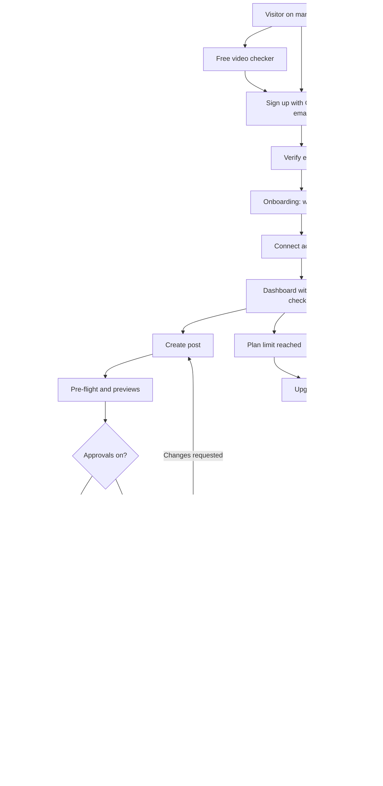
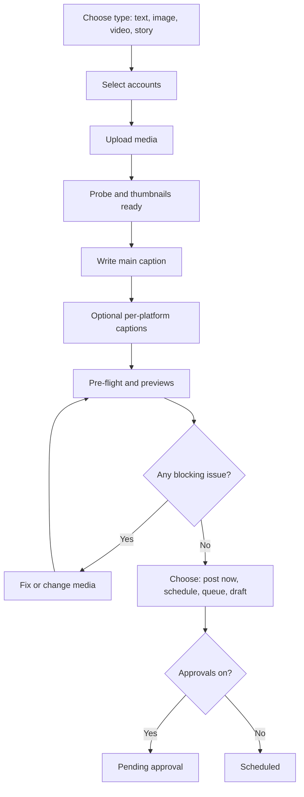
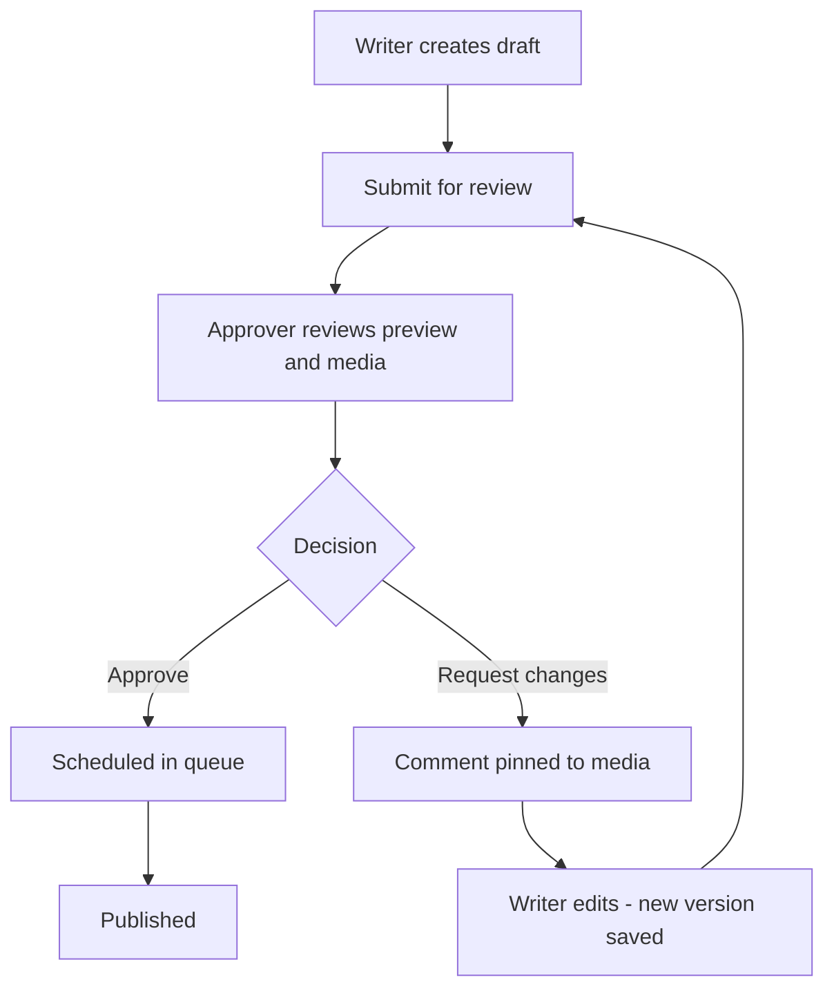
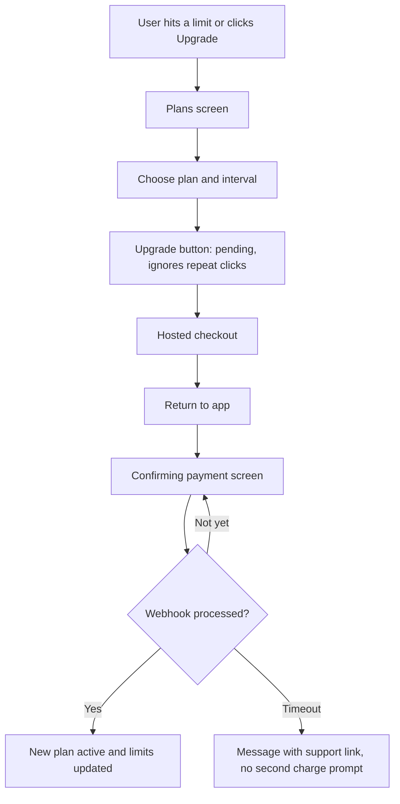

# Frontend guide — {{PRODUCT_NAME}}

The design system, screens, and user flows for everything the customer sees. Backend work is in `docs/BACKEND.md`. Rules are in `CLAUDE.md`. Test cases are in `docs/TEST.md`.

Last updated: 2026-10-22.

**Contents**

1. Design direction
2. Colour system
3. Typography
4. Layout, shape and motion
5. Components
6. Information architecture and routes
7. User flows (the project flow)
8. Key screens (wireframes)
9. States and microcopy
10. Forms, double-submit and autosave patterns
11. Data fetching and client state
12. Languages and right-to-left
13. Accessibility
14. Responsive and mobile
15. Performance
16. Analytics events
17. Code structure and rules
18. Frontend test map
19. Open decisions

---

## 1. Design direction

The colour combination comes from the reference image you shared (a lime announcement strip, near-black buttons and text, a coral-orange accent, on a clean white page). We borrow the **colours and the confident, high-contrast feel only**. We do not copy that company's logo, copy, imagery or layout.

**What the reference does that we adopt**

| Pattern | How we use it |
|---|---|
| Dismissible lime announcement strip above the navbar | Launch offers, the founding-customer price lock, maintenance notices. One at a time. |
| White canvas, near-black text | The default page. Calm and readable for long working sessions. |
| Near-black primary button, outlined secondary button | Primary actions are black (or lime on dark theme). One primary button per view. |
| Small monospace uppercase "eyebrow" label above the headline | Section labels on the marketing site only. App page headers and the app sidebar have none: icon and title only. |
| Large, light-weight, sentence-case headline in short lines ending in full stops | Marketing hero and empty states. |
| Product screenshot in a device frame, over a big coral shape | Marketing hero. The coral shape is decorative only. |
| Full-width coral band with white logos and a proof statement | Social proof strip on the marketing home page. |
| Soft pastel colours for avatars and tags | Avatars, labels, and chart backgrounds. |

**Design principles** (from the product plan)

1. **Fast to first success.** A new user schedules a first post in under 5 minutes.
2. **Never lose work.** Autosave, undo, version history, confirmation before anything destructive.
3. **Show the truth.** Previews match reality. Statuses are honest. Failures are visible, with a fix.
4. **Calm density.** Lots of information for professionals, without clutter. Use whitespace and grouping, not boxes.
5. **One pattern everywhere.** The same table, filter bar, dialog and empty state across the product.
6. **Built for every language.** Layouts survive long German words and right-to-left scripts.

**Sample marketing copy (placeholder, change once the name is decided)**

- Eyebrow: `SOCIAL MEDIA MANAGEMENT FOR TEAMS`
- Headline: "Post once. / Look right everywhere. / Keep every pixel."
- Sub: "Schedule to every platform, preview each one, and fix video problems before you publish."
- Buttons: **Start free** and *Start with Google*

---

## 2. Colour system

### 2.1 Sampled brand colours

Sampled from the pixels of the reference image.

| Name | Hex | Where it came from |
|---|---|---|
| Lime | `#DEFF00` | Announcement strip |
| Ink | `#1D1E20` | Headline text, black buttons |
| Coral | `#FF4B32` | Full-width band at the bottom |
| Coral soft | `#FF7D4B` | Lighter end of the large swoosh |
| White | `#FFFFFF` | Page background |
| Grey 50 | `#F4F4F5` | Light panels |
| Grey 600 | `#555657` | Secondary text |
| Dark canvas | `#111315` | Dark device screen (used as our dark theme background) |
| Pastels | `#DBE7FF` `#D1D6FF` `#AAD3C8` `#E0B5C1` `#FFE9D4` `#F38364` | Avatar colours |

### 2.2 How much of each

Aim for roughly: **85% white, grey and ink**, **10% coral**, **5% lime**.

| Colour | Use for | Never use for |
|---|---|---|
| **Ink** | Text, primary buttons, focus rings, icons | |
| **Lime** | Announcement strip, "new" or "founding" badges, highlights behind a word, primary button on the dark theme | Text on a light background (contrast 1.14:1), status colours |
| **Coral** | Decorative shapes, the social-proof band, chart series 2, large display text (24 px and up), brand moments | Error states, small text, white text on coral |
| **Coral strong** `#C23B22` | Small coral-coloured text when needed (5.33:1 on white) | Links (links are ink and underlined), error states |
| **Pastels** | Avatars, tags, soft backgrounds behind ink text | Text |

### 2.3 Two rules that come from the contrast numbers

1. **White text on coral fails the accessibility minimum** (3.33:1; the minimum for normal text is 4.5:1). On coral, use **ink** text (5.01:1).
2. **Coral is not an error colour.** It looks too much like red. Errors use a separate crimson `#B3261E`, and always come with an icon and words, never colour alone. Lime is not a success colour either; success is green.

### 2.4 Semantic tokens

These names match shadcn/ui, so generated components pick them up. Hex values only here; all values live in `app/globals.css`.

| Token | Light | Dark |
|---|---|---|
| `--background` | `#FFFFFF` | `#111315` |
| `--foreground` | `#1D1E20` | `#F4F4F5` |
| `--card` | `#FFFFFF` | `#1D1E20` |
| `--muted` | `#F4F4F5` | `#262729` |
| `--muted-foreground` | `#555657` | `#A3A4A6` |
| `--primary` | `#1D1E20` | `#DEFF00` |
| `--primary-foreground` | `#FFFFFF` | `#1D1E20` |
| `--secondary` | `#F4F4F5` | `#262729` |
| `--accent` | `#DEFF00` | `#262729` |
| `--accent-foreground` | `#1D1E20` | `#F4F4F5` |
| `--border` (dividers, decorative) | `#E4E4E7` | `#2F3033` |
| `--input` (control outlines) | `#858688` | `#6B6C6F` |
| `--ring` (focus) | `#1D1E20` | `#DEFF00` |
| `--destructive` | `#B3261E` | `#FF8A80` |
| `--shell` (app sidebar and the frame around the page panel) | `#F7F6F3` | `#0B0C0D` |
| `--shell-hover` (sidebar item hover) | `#EAE8E5` | `#232427` |
| `--brand-lime` | `#DEFF00` | `#DEFF00` |
| `--brand-coral` | `#FF4B32` | `#FF4B32` |
| `--brand-coral-strong` | `#C23B22` | `#FF6A52` |

**Status colours** (always shown with an icon and a text label)

| Status | Text, light | Background, light | Text, dark |
|---|---|---|---|
| Success | `#17692F` | `#E6F4EA` | `#5BD68B` |
| Warning | `#8A5300` | `#FFF4D6` | `#FFC15A` |
| Info | `#2349B8` | `#DBE7FF` | `#8FB4FF` |
| In review | `#4B35B8` | `#EEEBFF` | `#B7A6FF` |
| Danger | `#B3261E` | `#FDECEA` | `#FF8A80` |

In the dark theme, status backgrounds are `--muted` (`#262729`) with a 1 px border in the status colour at 40% opacity.

### 2.5 Verified contrast

Checked with the WCAG formula. Normal text needs 4.5:1, large text and control outlines need 3:1.

| Text | On | Ratio | Result |
|---|---|---|---|
| `#1D1E20` | `#FFFFFF` | 16.68 | Pass |
| `#FFFFFF` | `#1D1E20` | 16.68 | Pass |
| `#1D1E20` | `#DEFF00` | 14.62 | Pass |
| `#1D1E20` | `#FF4B32` | 5.01 | Pass |
| `#555657` | `#FFFFFF` | 7.36 | Pass |
| `#555657` | `#F4F4F5` | 6.69 | Pass |
| `#C23B22` | `#FFFFFF` | 5.33 | Pass |
| `#B3261E` | `#FFFFFF` | 6.54 | Pass |
| `#B3261E` | `#FDECEA` | 5.72 | Pass |
| `#17692F` | `#E6F4EA` | 5.97 | Pass |
| `#8A5300` | `#FFF4D6` | 5.78 | Pass |
| `#2349B8` | `#DBE7FF` | 6.22 | Pass |
| `#4B35B8` | `#EEEBFF` | 7.18 | Pass |
| `#858688` (input outline) | `#FFFFFF` | 3.64 | Pass (3:1) |
| `#F4F4F5` | `#111315` | 16.94 | Pass |
| `#A3A4A6` | `#111315` | 7.46 | Pass |
| `#A3A4A6` | `#1D1E20` | 6.69 | Pass |
| `#DEFF00` | `#111315` | 16.32 | Pass |
| `#FF4B32` | `#111315` | 5.59 | Pass |
| `#FF8A80` | `#111315` | 8.16 | Pass |
| `#5BD68B` | `#111315` | 10.14 | Pass |
| `#FFC15A` | `#111315` | 11.55 | Pass |
| `#8FB4FF` | `#111315` | 8.99 | Pass |
| `#B7A6FF` | `#111315` | 8.79 | Pass |
| `#6B6C6F` (dark input outline) | `#1D1E20` | 3.18 | Pass (3:1) |

**Combinations that fail. Do not use.**

| Text | On | Ratio |
|---|---|---|
| `#FFFFFF` | `#FF4B32` | 3.33 (large text or graphics only) |
| `#FF4B32` | `#FFFFFF` | 3.33 (large text or graphics only) |
| `#DEFF00` | `#FFFFFF` | 1.14 |
| `#969697` | `#FFFFFF` | 2.96 |

Re-check every new colour pair against `TEST.md` A11Y-04 in both themes before it ships.

### 2.6 Chart colours

Colours alone never carry meaning. Pair each series with a marker shape or line style and a direct label, and name the data source on every chart. Run the set through a colour-blind simulator before release.

| Series | Light theme | Dark theme |
|---|---|---|
| 1 | `#1D1E20` | `#F4F4F5` |
| 2 | `#FF4B32` | `#FF6A52` |
| 3 | `#2F6FE4` | `#6FA0FF` |
| 4 | `#12806E` | `#3FCDB5` |
| 5 | `#6E4FE0` | `#A58CFF` |
| 6 | `#B87400` | `#F2B33D` |

Platform brand colours (Instagram, TikTok and so on) appear only on platform icons and small status chips, never as page colours.

### 2.7 CSS variables (starting point)

Using shadcn/ui variable names. If you scaffold with Tailwind v4, map them with `@theme inline` (check the current shadcn/ui and Tailwind docs for exact syntax when you scaffold).

```css
/* app/globals.css */
:root {
  /* brand, sampled from the reference image */
  --brand-lime: #DEFF00;
  --brand-ink: #1D1E20;
  --brand-coral: #FF4B32;
  --brand-coral-soft: #FF7D4B;
  --brand-coral-strong: #C23B22;

  /* app shell: sidebar and the frame around the white page panel */
  --shell: #F7F6F3;
  --shell-hover: #EAE8E5;

  --background: #FFFFFF;
  --foreground: #1D1E20;
  --card: #FFFFFF;
  --card-foreground: #1D1E20;
  --popover: #FFFFFF;
  --popover-foreground: #1D1E20;
  --primary: #1D1E20;
  --primary-foreground: #FFFFFF;
  --secondary: #F4F4F5;
  --secondary-foreground: #1D1E20;
  --muted: #F4F4F5;
  --muted-foreground: #555657;
  --accent: #DEFF00;
  --accent-foreground: #1D1E20;
  --destructive: #B3261E;
  --destructive-foreground: #FFFFFF;
  --border: #E4E4E7;
  --input: #858688;
  --ring: #1D1E20;
  --radius: 0.5rem;

  --success-fg: #17692F;  --success-bg: #E6F4EA;
  --warning-fg: #8A5300;  --warning-bg: #FFF4D6;
  --info-fg:    #2349B8;  --info-bg:    #DBE7FF;
  --review-fg:  #4B35B8;  --review-bg:  #EEEBFF;
  --danger-fg:  #B3261E;  --danger-bg:  #FDECEA;

  --chart-1: #1D1E20; --chart-2: #FF4B32; --chart-3: #2F6FE4;
  --chart-4: #12806E; --chart-5: #6E4FE0; --chart-6: #B87400;
}

.dark {
  --shell: #0B0C0D;
  --shell-hover: #232427;
  --background: #111315;
  --foreground: #F4F4F5;
  --card: #1D1E20;
  --card-foreground: #F4F4F5;
  --popover: #1D1E20;
  --popover-foreground: #F4F4F5;
  --primary: #DEFF00;
  --primary-foreground: #1D1E20;
  --secondary: #262729;
  --secondary-foreground: #F4F4F5;
  --muted: #262729;
  --muted-foreground: #A3A4A6;
  --accent: #262729;
  --accent-foreground: #F4F4F5;
  --destructive: #FF8A80;
  --destructive-foreground: #111315;
  --border: #2F3033;
  --input: #6B6C6F;
  --ring: #DEFF00;
  --brand-coral-strong: #FF6A52;

  --success-fg: #5BD68B;
  --warning-fg: #FFC15A;
  --info-fg: #8FB4FF;
  --review-fg: #B7A6FF;
  --danger-fg: #FF8A80;
  --success-bg: #262729; --warning-bg: #262729; --info-bg: #262729;
  --review-bg: #262729;  --danger-bg: #262729;

  --chart-1: #F4F4F5; --chart-2: #FF6A52; --chart-3: #6FA0FF;
  --chart-4: #3FCDB5; --chart-5: #A58CFF; --chart-6: #F2B33D;
}
```

**Theme behaviour:** follow the system setting by default, with a toggle in the user menu. Set the theme before first paint so there is no flash.

---

## 3. Typography

| Role | Font | Notes |
|---|---|---|
| UI and body | Inter (variable) | Self-host with `next/font`. Brand font is an open decision (section 19). |
| Display headlines (marketing) | Inter at weight 300, tight tracking (-0.02em), line height 1.05 | Gives the light, large feel of the reference |
| Eyebrow labels | A monospace face (Geist Mono or JetBrains Mono), uppercase, letter-spacing 0.08em, 12–13 px | In Arabic there is no uppercase, so use the normal UI font in regular case |
| Arabic | Noto Sans Arabic | Matches Inter's weight range |
| Numbers in analytics | Inter with tabular figures (`font-variant-numeric: tabular-nums`) | Columns line up |

**Scale** (px; use `rem`)

| Token | App | Marketing |
|---|---|---|
| `text-xs` | 12 | 12 |
| `text-sm` | 14 | 14 |
| `text-base` | 16 | 16–18 |
| `text-lg` | 18 | 20 |
| `text-2xl` | 24 | 28 |
| `text-4xl` | 32 | 40–48 |
| `text-6xl` | — | 56–72 (fluid, `clamp()`) |

Rules: sentence case for all labels and buttons. Body text 16 px minimum on mobile. Line length 60–75 characters. Never use more than two weights on one screen.

---

## 4. Layout, shape and motion

- **Grid:** 4 px base unit. Page gutters 16 px on phones, 24 px on tablets, 32+ px on desktop. Marketing content max width 1200 px; app content fills the shell, with forms capped at 640 px.
- **Radius:** 4 px for buttons and inputs (the reference uses crisp, lightly rounded buttons), 8 px for cards, 12 px for dialogs and sheets, full for chips and avatars.
- **App shell (from `lg`):** the sidebar sits on `--shell`. The page is a white panel inset 8 px from the top, end and bottom, with a 12 px radius and a 1 px border; it scrolls on its own, so the sticky header stays inside the rounded corners. Below `lg` the page is plain white with the bottom bar.
- **Sidebar:** items 32 px tall and 2 px apart, near-black text, `--shell-hover` on hover, sky for the current page. Groups are separated by a 12 px gap with no visible headings. Below the main items, an **Accounts** list (one row per connected account: platform mark, name, scheduled count, an amber dot when it needs reconnecting; the open account shows its Insights and Posts sub-items), then platform marks to connect more. A **profile button** sits at the bottom (you, the workspace and its plan) and opens the account menu: profile, preferences, billing, theme, sign out.
- **Settings area:** any `/dashboard/settings/*` page swaps the sidebar for the settings list (Profile, Preferences · Workspace, Team, Social accounts, Billing · Tags) with a back arrow. Pages are a centred column of titled cards; each row has the label and help on the start side and the control on the end side. Preferences save on change, with a toast; forms with free text (profile name) have a Save button that stays disabled until something changed.
- **Pills:** toggles, usage tags and the calendar's arrows and Today button are fully rounded. A search box in a filter bar is 32 px tall with an 8 px radius.
- **Elevation:** three levels only. Flat (borders), raised (cards on hover, popovers), overlay (dialogs). Prefer a 1 px border to a shadow.
- **Control heights:** 32 (compact), 40 (default), 48 (hero and mobile primary).
- **Icons:** one set (Lucide). 16, 20 and 24 px. Mirror directional icons in right-to-left.
- **Motion:** 150–250 ms ease-out for state changes. No decorative animation. Honour `prefers-reduced-motion` by removing movement and keeping fades.
- **Focus ring:** 2 px ring in `--ring` with a 2 px offset. On dark theme the ring is lime. Never remove outlines without a replacement.
- **Breakpoints:** `sm` 640, `md` 768, `lg` 1024, `xl` 1280, `2xl` 1536.

---

## 5. Components

Build on shadcn/ui primitives, but **wrap** them in our own components so tokens, states and translations live in one place. Do not heavily edit generated primitives.

Every component must define: default, hover, focus-visible, active, disabled, loading, error. Test it in both themes, in right-to-left, and with text 40% longer.

| Component | Variants and notes |
|---|---|
| **Button** | `primary` (ink; lime on dark), `secondary` (outlined ink), `accent` (lime, for promos only), `destructive`, `ghost`, `link` (ink, underlined). Sizes 32/40/48. `loading` shows a spinner, keeps width, sets `aria-busy`, and **ignores further activation** (section 10). Icon-only buttons need an `aria-label`. |
| **Input, Textarea, Select** | Visible label above, helper text below, error text with an icon. Outline uses `--input`. Character counter for captions. Filter bars use the borderless `Select variant="ghost"`. |
| **Combobox** | Account picker and market picker: searchable, multi-select, remembers the last selection, keyboard operable. |
| **Status chip** | Draft (grey), In review (violet), Scheduled (ink outline), Published (green), Partial (amber), Failed (crimson), Lapsed (amber), Needs reconnect (amber). Always icon + text. |
| **Platform badge** | The platform's logo (Simple Icons glyph, CC0, kept in `providers/<platform>` as `logo`) drawn white on its brand colour (`markBackground` for Instagram's gradient), plus the account name in text. Never a two-letter monogram. |
| **Avatar** | Image or initials on a pastel from the sampled set; the pastel is chosen by hashing the user ID so it stays stable. |
| **Table** | Sticky header, sortable columns, row selection, bulk-action bar, column visibility, density toggle. Becomes cards below `md`. |
| **Filter bar** | Buffer-style. List tabs on the left; on the right of the same row (from `xl`; below that, a row under the tabs) a small search box and borderless dropdowns for platform and tags: label and chevron, a muted fill on hover or open, a shadowed menu. Same pattern on Posts and Calendar, later Inbox and Analytics. Saved views and "clear all" come later. |
| **Dialog and Sheet** | Dialog for decisions, sheet for detail panels and mobile. Trap focus, close on Escape, return focus to the trigger. |
| **Toast** | Success and info only; errors that need action stay inline. Undo toast for quick destructive actions (8 s). |
| **Banner** | `announcement` (lime, dismissible), `warning` (amber, for needs-reconnect and plan limits), `danger`, `info`. Persist dismissal per user. |
| **Empty state** | Illustration or icon, one sentence on what this is, one primary action. Never a blank area. |
| **Skeleton** | Matches the final layout to prevent layout shift. |
| **Tabs** | Underlined tabs for the Posts lists (All posts, Scheduled, Posted, Drafts) and per-platform caption editing. Posts tabs live in `?tab=` on one route, switch without reloading, and keep search and filters. Caption tabs use arrow-key navigation. |
| **Segmented toggle** | A pill track with a 1 px border and the chosen option filled in ink (`components/ui/segmented.tsx`). Monthly/Yearly on Billing and Pricing; Month/Week/List on the Calendar. |
| **Page header** | Tinted icon tile, title, optional one-line description, actions at the end. No eyebrow. |
| **Calendar** | Month, week, list, and queue views. Drag to reschedule **and** a keyboard/menu way to move a post. Status colour plus icon on each item. |
| **Preview frame** | Composer preview per platform, drawn from the platform's `preview` spec: a vertical player for Shorts, Reels and TikTok (video plays muted with play/pause, sound and progress; side rail of actions; handle with Follow or Subscribe; caption or title), a feed card for Facebook, LinkedIn, Bluesky and Instagram photos (header, text above or below the media, carousel or grid for several photos, action bar), and a Story frame. Landscape video shows with bars until the "Make 9:16" fix is on, then fills the frame. A disconnected or unsupported combination shows why instead. The free video checker keeps the simpler frame with safe-zone guides. |
| **Pre-flight item** | Icon (pass, warn, block), rule title, one-line explanation, optional fix button. |
| **Upload dropzone** | In the composer, the caption box is the drop zone: drop files anywhere on it, paste an image into the text, or use "Add photos or a video". Thumbnails sit inside the box under the text, each with its own progress bar, pause/resume, remove, and a warning badge when pre-flight finds something; a dashed "Add" tile adds more. Several photos upload side by side. |
| **Plan card** | Name, price (monthly/yearly toggle), accounts and seats, feature list from `plans.ts`, current-plan badge. |
| **Account insights** | Per account (`/dashboard/accounts/[id]`): header with platform mark, name and handle; Insights and Posts tabs; a 7 / 30 / 90 day toggle and an "Updated …" time; stat tiles for the platform's own metrics (`providers/<platform>` `insights.metrics`, with its own words such as LinkedIn "Reactions" or YouTube "Subscribers"), each with the change against the previous period (icon + text, never colour alone); one single-series column chart with a metric switcher (new followers, posts, engagements; weekly columns for 90 days); a per-post table sortable by any metric, where posts made outside the app are labelled. A disconnected account shows its last numbers with a reconnect notice. |
| **Export menu** | "Export" on an account's Insights: CSV (per-post rows, raw numbers, UTF-8 with BOM, formula-like cells prefixed), Markdown (summary and posts tables) and PDF (a print-ready report through the print dialog's Save as PDF, so every script and emoji renders). File names: `<account>-<platform>-insights-<from>-to-<to>`. |
| **Usage tag** | A bordered pill with the label and the count in a filled tag ("Social accounts · 4 of 25"); the tag turns amber at the limit. Used on Billing instead of meters. |
| **Workspace switcher, market switcher** | Searchable list in the header, with the current workspace's plan badge. |
| **Language switcher** | Shows each language in its own name; a globe icon button in the navbar and in the user menu (section 12). |
| **Command palette** | Keyboard shortcut opens search for pages, posts, accounts and actions. |
| **Notification bell** | Unread count, grouped list, mark all read, link to settings. |

---

## 6. Information architecture and routes

All routes sit under a locale prefix: `/[locale]/...` (for example `/en/pricing`, `/es/pricing`).

### Marketing and public

| Route | Purpose |
|---|---|
| `/` | Landing page (hero, product sections, proof band, pricing teaser, FAQ) |
| `/pricing` | Plans, monthly/yearly toggle, comparison table |
| `/product/publish`, `/product/engage`, `/product/operate` | Module pages |
| `/compare/[competitor]`, `/alternatives/[competitor]`, `/switch-from/[competitor]` | Comparison and switching pages (see `docs/SEO-AEO.md`) |
| `/tools/video-checker` (and other free tools) | Free tools, no login |
| `/blog`, `/docs`, `/changelog` | Content |
| `/privacy`, `/terms`, `/data-deletion`, `/contact` | Legal and support |
| `/login`, `/signup`, `/forgot-password`, `/reset-password`, `/auth/callback` | Authentication |
| `/approve/[token]` | Client approval link, no login |
| `/submit/[token]` | Local contributor submission link, no login (multi-market) |

### Onboarding

`/onboarding/start` (who you are) → `/onboarding/connect` → `/onboarding/plan` (optional in value-first mode) → `/onboarding/done`.

### App (`/dashboard/...`, signed in)

| Area | Routes |
|---|---|
| Home | `/dashboard` |
| Create | `create`, `create/[type]` (text, image, video or story), `studio`, `studio/[template]`, `bulk-tools`, `bulk-tools/[kind]` (video, image or create) |
| Posts | `posts/calendar`, `posts` (tabs: All, Scheduled, Posted, Drafts via `?tab=`), `posts/[id]`, `plan` |
| Engage (later) | `inbox`, `inbox/[id]`, `saved-replies`, `content-inbox` |
| Operate (later) | `analytics`, `locations`, `locations/[id]`, `apps`, `apps/[id]`, `reports`, `reports/[id]` |
| Accounts | `accounts/[id]` (insights), `accounts/[id]/posts` |
| Workspace | `library`, `markets`, `markets/[id]`, `clients` |
| Settings | `settings` (opens Profile), `settings/profile`, `settings/preferences`, `settings/workspace`, `settings/team`, `settings/accounts`, `settings/billing`, `settings/tags`; later `settings/queue`, `api-keys`, `plans`, `referrals` |

### Navigation

- **Marketing navbar:** logo, Product, Pricing, Free tools, Resources, **language switcher**, Log in, Start free. Lime announcement strip above it when active.
- **App header:** workspace switcher, market switcher (when markets exist), global search, notifications, language, user menu.
- **App sidebar:**
  - Create: New post, Studio, Bulk tools
  - Posts: Calendar, All posts (Scheduled, Posted and Drafts are tabs inside it), Plan
  - Engage: Inbox (unread count), Saved replies
  - Operate: Analytics, Locations, Apps, Reports
  - Workspace: Connections, Markets, Teams, Clients, Library
  - Configuration: Settings, AI agents and API, Billing
  - Support: Feedback, Referral, Docs
  Hide sections for modules that are not live yet instead of showing disabled links. The group names above are for planning only: the app shows the groups separated by a small gap, without headings (Buffer-style). Team, social accounts and billing live in the settings area, reached from the profile button; connected accounts are listed in the sidebar itself (§4).
- **Phones:** the sidebar becomes a bottom bar with Home, Calendar, Create, Inbox, More.

---

## 7. User flows (the project flow)

### 7.0 The whole journey



Account-creation order is **value first** (recommended in the plan for the first 100 users): the user reaches the dashboard on a free or trial plan, and the paywall appears only when a limit is reached. If you later switch to card-first, only flows F1 and F9 change.

### F1. Visitor to dashboard

- **Entry:** marketing page, free tool, comparison page, or a shared approval link.
- **Steps**
  1. `/signup`: "Start with Google" or email and password. Shows password rules inline and allows paste.
  2. Email verification: "Check your inbox" screen with a resend button (cooldown shown). The link opens a confirm button (not auto-consumed).
  3. `/onboarding/start`: "What best describes you?" (solo creator, startup, agency, other). Stored on the profile. Skippable.
  4. `/onboarding/connect`: grid of platforms. Each opens that platform's own sign-in screen, then returns here. Skippable.
  5. `/onboarding/plan`: shown only if the user hit a paid feature, or in card-first mode. Otherwise skipped.
  6. `/onboarding/done` → `/dashboard` with the **first-post checklist**: connect an account, upload a video, schedule a post.
- **System:** one transaction creates the profile, the default workspace and the membership. The workspace starts a 14-day trial (no card).
- **Edge cases:** email already registered (neutral message), verification link expired (resend), Google sign-in cancelled, user closes the tab mid-onboarding (resume where they left off on next sign-in).
- **Success:** user reaches the dashboard. Metric: signup → first account connected within 24 hours.

### F2. Free video checker (acquisition tool)

- **Entry:** `/tools/video-checker`, no sign-in.
- **Steps:** drop a video → short "Checking…" state with progress → per-platform report (aspect ratio, resolution, bitrate, duration, size, each marked pass, warn, block) → "Fix and schedule this" button → sign-up with the file kept for after sign-in.
- **Notes:** the report uses the same rules as the product's pre-flight. Show only the first findings before sign-up if abuse is a concern; never block the whole report. Files from anonymous users are deleted after a short period and the page says so.
- **Edge cases:** file too large, unsupported type, upload interrupted (resume), corrupt video (clear message).
- **Metric:** tool use → sign-up rate.

### F3. Connect and reconnect an account

- **Entry:** onboarding, `/dashboard/settings/accounts`, the sidebar's "+" or a platform mark under "Connect more" (opens straight at that platform), or a "Reconnect" banner.
- **Steps**
  1. Choose a platform. A short sheet explains what we will be able to do and what we will not (scopes in plain words).
  2. Redirect to the platform's own consent screen.
  3. Return to `/dashboard/settings/accounts` with a success toast and the new account in the list and the sidebar.
- **Reconnect:** accounts in `needs_reconnect` show an amber banner and a dot. "Reconnect" repeats the flow and restores the paused queue. Scheduled posts for that account are listed so the user sees what is waiting.
- **Remove account:** confirmation names the number of scheduled posts that will be affected.
- **Edge cases:** user denies permission (explain what is missing), wrong account type (for example a personal Instagram account when a business one is needed, with a link to how to switch), plan account limit reached (upgrade prompt), account already connected in another workspace (clear message).

### F4. Create and schedule a post



1. **Type.** `create` page offers four types. Last-used type is preselected, and the type follows the media: adding a video to an empty post makes it a video post, adding photos makes it an image post (Story stays a story). Mixing photos and a video is refused with a short message.
2. **Accounts.** Multi-select combobox, remembers the last selection. Accounts needing reconnect are shown disabled with the reason.
3. **Media.** Inside the caption box (§5 Upload dropzone): one video, or up to the largest photo count among the chosen platforms (each platform's `maxImages`; fewer is flagged per platform by the "Number of photos" check). Upload goes straight to storage in parts, with progress, pause, resume and cancel per file. After upload a short "Checking" state shows until the details (size, length, codec) are ready. In preview mode the files are also kept in the browser (IndexedDB), so a restored draft still shows them after a reload.
4. **Caption.** One main caption, plus tabs to override per platform. Live character counters per platform. Autosave indicator ("Saved 2 s ago") and version history.
4a. **Platform settings.** For each chosen account whose platform asks for more (`publishOptions`): YouTube shows Title (defaults to the first line of the caption, 100 characters), Visibility (Public, Unlisted, Private), Made for kids, Notify subscribers and Allow embedding. Saved per account as `targetOptions` and shown on the post's side sheet ("· Unlisted" and the title).
5. **Pre-flight and previews** (F5).
6. **Timing.** Post now, Schedule (date, time, timezone: the user picks the timezone first, then the time), Add to queue, or Save as draft. The summary line states the time in the user's timezone and in each market's timezone when markets exist.
7. **Submit.** Button shows a pending state and ignores repeat clicks. If approvals are on, the status becomes Pending approval and the user sees who will review.
8. **After submit.** Confirmation with a link to the calendar. The post shows per-platform status as it publishes (live updates).

- **Edge cases:** upload fails (retry), session expires (draft kept, sign in again), account disconnected after selection (blocked with reason), scheduled time in the past (blocked), DST gap (explained), two people editing (presence and conflict notice), connection lost (offline banner, draft kept locally).
- **Metric:** time from "New post" to scheduled; share of posts scheduled with no blocking issue.

### F5. Pre-flight and fix (the differentiator)

- **Where:** right panel in the composer, and the free tool.
- **Steps**
  1. Each selected platform gets a preview in a phone frame with crop and safe-zone overlays.
  2. A checklist lists checks (aspect ratio, resolution, bitrate, duration, file size, caption length), each `pass`, `warn` or `block`, with a one-line reason.
  3. A fix button sits next to each issue ("Create a 9:16 version", "Trim to 60 s").
  4. Choosing a fix creates a **new derived file**, shows before and after, and lets the user undo. The original is never changed.
  5. If nothing is wrong, the panel says "We will send your original file unchanged."
- **Rules:** warn rather than block unless the platform will reject the post. Never re-encode silently.
- **Edge cases:** very large video (progressive results), unsupported codec, rotation metadata, no audio.

### F6. Calendar and queue

- **Entry:** `/dashboard/posts/calendar`.
- **Views:** Month, Week and List in a pill toggle; Queue later. Borderless previous/next arrows and a Today button. Filters for platform and tags now (borderless dropdowns); account, assignee, campaign and market later.
- **Actions:** click a post to open a side sheet; drag to reschedule **or** use the "Move" menu with keyboard; best-time overlay; bulk select; create a post at a clicked time.
- **Queue:** per-account time slots at `/dashboard/settings/queue`. "Add to queue" picks the next free slot.
- **Edge cases:** failed or lapsed posts are highlighted with a one-click fix; empty calendar shows a sample plan.

### F7. Team approval (inside the workspace)



- Roles: owner, admin, editor, viewer, and reviewer (comment and approve only).
- Comments can be pinned to a time in a video or a spot on an image. Each round is saved as a version, with compare.
- Editing after approval cancels the approval and tells the approver.
- Notifications: in-app bell plus email, with batching so 100 comments do not mean 100 emails.

### F8. Client approval by link

- **Entry:** agency sets a post to "Needs approval"; the client receives an email with `/approve/[token]`.
- **Steps:** read-only preview per platform → Approve, or Request changes with comments pinned to the media. No account needed. Works on a phone.
- **Outcome:** Approved → Scheduled. Changes requested → back to Draft with the comment attached; the agency is notified.
- **Safety:** the link is one object only, expires, and can be revoked. The page is `noindex`, uses the viewer's language, and shows nothing outside that post.

### F9. Upgrade, billing and cancel



1. **Trigger.** Limit reached (accounts, seats, storage), locked feature, or the Billing page.
2. **Plans screen.** Monthly and yearly toggle (yearly = two months free), five plans with account and seat limits, honest note on what the trial includes, currency and language follow the visitor.
3. **Checkout.** Hosted by Lemon Squeezy. Our button creates one checkout and ignores repeat clicks.
4. **Return.** "Confirming your payment…" screen that checks until the server has the confirmed state. Access changes only when the server says so.
5. **Manage.** `/dashboard/settings/billing` shows one current-plan card (plan, renewal date, usage as pill tags for social accounts and seats, amber at the limit, and the invoices and payment link), then the plans with the Monthly/Yearly toggle. Next invoice, cancel and resume come with the customer portal.
6. **Cancel.** Access continues until the period ends, then the workspace moves to Free. Data is kept.
7. **Downgrade over limit.** The user sees exactly what is over the limit and what stays read-only. Nothing is deleted.
- **Only owners and billing admins** see billing actions.

### F10. Publishing failure and recovery

- **Partial or failed post:** the post card shows "Published on 3 of 4" with the failed platform highlighted, a plain-language reason ("Instagram rejected the video: it is longer than allowed"), and a fix button.
- **Expired or revoked connection:** banner "Reconnect Instagram", the account's queue is paused, an email is sent, and the affected posts are listed.
- **Lapsed post** (the time passed during an outage): listed on the home page with "Publish now", "Reschedule" or "Discard".
- **Retry:** one click, safe to press twice.

### F11. Invite teammates and manage roles

- `teams`: invite by email with a role. The invite email opens a confirm page, so email scanners do not use it up.
- Role changes take effect on the next click. Removing a member shows what happens to their drafts and assignments.
- Per-account and per-market permissions for agencies (an editor can see only the clients they are assigned to).

### F12. Inbox: read, reply, resolve (Engage, later)

- Three panes: filtered list, conversation with the original post (or app version), and a context panel (author, history, assignee, tags, saved replies).
- Reply box with AI draft, translate toggle, and a status (sending, sent, failed).
- Reply-window or API limits are shown as "Can't reply: reason", not as a failed send.
- Bulk actions: assign, resolve, mark spam.

### F13. Multi-market weekly cycle (later)

1. Monday: each market's local contact gets a request link (`/submit/[token]`) with the week's prompt.
2. By midweek: contacts submit updates, photos or video. Missing submissions trigger a reminder, then a flag to the planner.
3. Planner turns submissions into master pieces and creates variants per platform and language.
4. A local approver (or client link) reviews translations.
5. Approved variants are queued into each market's slots. The **Plan** grid shows any market below its target.
6. Inbox and analytics show what to make more of next week.

### F14. Switch from another tool

- **Entry:** `/switch-from/[competitor]` page, or Settings → Import.
- **Steps:** choose the tool → connect accounts → import scheduled posts and media library where the tool allows an export (CSV or file upload) → review the mapping (which account goes where) → confirm. A summary says what moved and what did not.
- **Offer:** founding price lock and free migration help for the first 100 customers.
- **Edge cases:** duplicate posts (detected and skipped), unsupported fields (listed), partial import (resumable).

### F15. Language change

- Globe button in the marketing navbar and in the app user menu. Each language is shown in its own name.
- Changing language keeps the current page, keeps the form content, and saves the choice to the cookie and the profile. We suggest a language once from the browser and never redirect by force.

### F16. Account recovery and security

- **Forgot password:** neutral message whether or not the email exists, single-use short-lived link, other sessions end after reset.
- **MFA:** enrol, recovery codes, lost-device path. Strongly suggested for owners and admins.
- **Sensitive actions** (change email, delete workspace, create API key, billing change) ask for the password again.
- **Sessions:** list of devices with "Sign out everywhere".

### F17. Account insights and export

- **Entry:** an account in the sidebar, "Insights" on Settings › Social accounts, or the Accounts list on phones (menu drawer).
- **Steps:** pick a period (7, 30 or 90 days) → read the summary tiles (each compared with the period before) → switch the chart between new followers, posts and engagements → sort the per-post table → open one of our posts in its side sheet → Export as CSV, Markdown or PDF. "New post" opens the composer with this account already selected (`/dashboard/create?account=<id>`).
- **Data:** `GET /workspaces/{ws}/accounts/{id}/insights?days=&tz=` (`AccountInsights` in `lib/api/types.ts`). Insights cover every post on the account, including ones published outside the app. Only the metrics the platform reports are shown; a missing metric is "–", never 0 (BACKEND.md §12).
- **Edge cases:** account removed or wrong id (empty state linking to Social accounts), account needs reconnecting (last numbers, the time they were updated, and a Reconnect button), no posts in the period (empty table with New post), switching periods keeps the old numbers dimmed until the new ones arrive.

---

## 8. Key screens (wireframes)

### Marketing home (inspired by the reference layout)

```text
+--------------------------------------------------------------------------------+
| [LIME STRIP]  Founding price for the first 100 customers. See offer →      [x] |
+--------------------------------------------------------------------------------+
| logo   Product v  Pricing  Free tools  Resources     (globe) (search)  Log in  [Start free] |
+--------------------------------------------------------------------------------+
| SOCIAL MEDIA MANAGEMENT FOR TEAMS  (mono eyebrow)        +--------------------+ |
|                                                          |  product screenshot| |
| Post once.                                               |  in device frame   | |
| Look right everywhere.                                   |  over a coral      | |
| Keep every pixel.                                        |  shape             | |
|                                                          +--------------------+ |
| Schedule to every platform, preview each one, and fix                          |
| video problems before you publish.                                             |
|                                                                                |
| [ Start free ]   [ G  Start with Google ]                                      |
+--------------------------------------------------------------------------------+
| [CORAL BAND]  Trusted by teams in N countries      logo logo logo logo logo    |
+--------------------------------------------------------------------------------+
```

### App shell

```text
 shell #F7F6F3    white page panel: 12 px radius, 8 px inset, scrolls on its own
+-----------+ .------------------------------------------------------------------.
| logo      | | [Workspace v] [Market v]   (search)      (bell) (globe) (user)    |
|           | +------------------------------------------------------------------+
| Home      | |  Good morning, Abdul                       [ New post ]          |
| New post  | |                                                                  |
| Calendar  | |  +----------+ +--------------+ +-------------+ +-------------+   |
| All posts | |  | My work  | | Needs review | | This week   | | Needs reply |   |
|           | |  +----------+ +--------------+ +-------------+ +-------------+   |
| Accounts +| |                                                                  |
| [IG] Nor 3| |  First-post checklist:  [x] Connect  [ ] Upload  [ ] Schedule    |
|   Insights| |                                                                  |
|   Posts   | |  Connection problems: Instagram needs reconnecting [Reconnect]   |
| [TT] Nor 3| |                                                                  |
| Connect   | '------------------------------------------------------------------'
| [FB][BS]  |
|           |
| (AM) Alex |   Profile button: account menu (profile, preferences, billing,
| Studio·Pro|   theme, sign out). Settings swap this list for their own.
+-----------+
```

### Posts

```text
[icon] Posts                                                         [ + New post ]
 All posts   Scheduled   Posted   Drafts       (search...)  All platforms v  Tags v
 =========
| Post                          | Accounts | When             | Status        |
| Caption excerpt  [tag] [tag]  | IG TT    | Oct 31, 5:00 PM  | (Scheduled)   |
| Caption excerpt  [tag]        | YT       | No time set      | (Draft)       |
Tabs are ?tab= on /dashboard/posts. Below xl the search and filters wrap under the tabs;
below md the table becomes cards.
```

### Composer

```text
+--------------------------------------------------------------------------------+
| New video post        Saved 2 s ago   Version history        [Save draft]       |
+----------------------+-----------------------------------+---------------------+
| ACCOUNTS             | MEDIA                             | PREVIEW             |
| [search]             | +-------------------------------+ | [Instagram][TikTok] |
| [x] Instagram @brand | |  drop video here              | |  +---------------+  |
| [x] TikTok  @brand   | |  upload 62%  [pause][cancel]  | |  | phone frame   |  |
| [ ] YouTube @brand   | +-------------------------------+ |  | crop + safe   |  |
| [!] LinkedIn         |                                   |  | zones         |  |
|    needs reconnect   | CAPTION                           |  +---------------+  |
|                      | [Main][Instagram][TikTok]         |                     |
|                      | [ text area .................. ]  | PRE-FLIGHT          |
|                      | 120 / 2200   Instagram            |  [!] 16:9 will be   |
|                      | 120 / 2200   TikTok               |      cropped        |
|                      |                                   |      [Make 9:16]    |
|                      |                                   |  [ok] Duration      |
|                      |                                   |  [ok] File size     |
|                      |                                   |  WHEN               |
|                      |                                   |  ( ) Post now       |
|                      |                                   |  (o) Schedule       |
|                      |                                   |   Tue 28 Oct 09:00  |
|                      |                                   |   Asia/Karachi      |
|                      |                                   |  [ Schedule post ]  |
+----------------------+-----------------------------------+---------------------+
```

Character limits shown above are illustrative. Read real limits from the platform limits data (see `docs/BACKEND.md`).

### Calendar

```text
 <  >  Today   October 2026          ( [Month] Week  List )   All platforms v   Tags v
|-----------------------------------------------------------------------------|
| Mon      | Tue            | Wed        | Thu     | Fri        | Sat | Sun     |
|          | [ok IG 09:00]  |            |         | [rev TT]   |     |         |
|          | [sch YT 12:00] |            |         |            |     |         |
Legend: draft, in review, scheduled, published, failed   (each = colour + icon + label)
```

### Approval page (reviewer, no login)

```text
+--------------------------------------------------------------+
| Review: Autumn launch video            from Agency Name      |
| [Instagram][TikTok]     phone-frame preview                   |
| Version 3  (compare with 2)    Comments pinned to the video  |
| [ Request changes ]                     [ Approve ]          |
+--------------------------------------------------------------+
```

---

## 9. States and microcopy

Every screen defines all of these before it is built:

| State | Rule |
|---|---|
| **Empty** | Says what this area is and gives one next action ("No posts yet. Create your first post."). |
| **Loading** | Skeleton that matches the final layout. Never a blank page. Feedback within about 100 ms. |
| **Error** | What happened, why, what to do, plus Retry. No stack traces or codes without a plain sentence. |
| **Partial** | "Published on 3 of 4 platforms", failed one highlighted with its fix. |
| **Offline or slow** | Banner "You're offline. Your draft is saved on this device." Drafts kept locally. |
| **Destructive** | Confirmation that names the effect ("Delete 3 scheduled posts?") or an undo toast. |
| **Success** | Short toast or inline note. Do not celebrate routine actions. |

**Writing rules**

- Plain words, short sentences, sentence case.
- One term per thing: always "account" (never "channel" or "profile"), "workspace", "post".
- Error format: what happened → why → what to do. Example: "Instagram rejected this video. It is longer than 90 seconds. Trim it or use the 'Trim to 90 s' fix."
- Every string is written for translation: no joined fragments, room for 40% longer text, no text inside images.

---

## 10. Forms, double-submit and autosave patterns

These patterns satisfy `TEST.md` DBL-01 to DBL-25.

**1. One intent, one key.** Make an idempotency key when the form opens (or when the user starts the action). Reuse it for retries of the same intent. Make a new one only after success or after the user changes the form.

```tsx
// src/lib/use-intent-key.ts
import { useRef } from 'react';

export function useIntentKey() {
  const ref = useRef<string>(crypto.randomUUID());
  return {
    get: () => ref.current,
    renew: () => { ref.current = crypto.randomUUID(); },
  };
}
```

**2. Submit button ignores repeats.**

```tsx
// Example with TanStack Query
const intent = useIntentKey();
const schedule = useMutation({
  mutationFn: (input: SchedulePostInput) =>
    schedulePost(input, { idempotencyKey: intent.get() }),
  onSuccess: () => intent.renew(),
});

<Button
  data-testid="schedule-post"
  onClick={() => { if (!schedule.isPending) schedule.mutate(values); }}
  disabled={schedule.isPending}
  aria-busy={schedule.isPending}
>
  {schedule.isPending ? t('common.saving') : t('composer.schedule')}
</Button>
```

Disabling is not the only protection. The server also uses the key, and the database has unique constraints (see `BACKEND.md`).

**3. Autosave.**

- Debounce about 1 second after the last keystroke. Flush on blur, route change, and `visibilitychange`.
- First save creates the draft; later saves update the same ID, even if the first response is slow.
- Every save carries a version number. If the server's version is newer, show a conflict notice instead of overwriting.
- Out-of-order responses are ignored: keep a local sequence number and apply only the latest.
- Keep a local copy of the draft until the server confirms, so a lost connection or an expired session does not lose work.

**4. Search and filters.** Debounce about 300 ms and cancel the previous request with `AbortController`.

**5. Throttle** scroll, drag, resize and live-preview updates to at most one per animation frame, or every 100–250 ms.

**6. Validation.** `react-hook-form` with a shared `zod` schema (the same schema the server uses). Validate on blur and on submit. Show errors next to the field and in a summary that receives focus on submit. Never ask for the same information twice in one flow.

---

## 11. Data fetching and client state

- **Read on the server when possible** (React Server Components). Use TanStack Query for interactive client data such as the calendar, the inbox list and live status.
- **Query keys always include the workspace ID and the user ID.** This stops one user's cached data from showing for another (`TEST.md` AUTHZ-12).
- **Live updates:** subscribe to post-status changes through Supabase Realtime for the active workspace. Reconnect with backoff and refetch what was missed.
- **Mutations:** use server actions for UI mutations. Optimistic updates only where rollback is simple, and always with a visible rollback message.
- **Retries:** GET requests retry a few times with backoff. Mutations are never retried automatically unless they carry an idempotency key.
- **Never in the browser:** platform tokens, the service-role key, encryption keys. Only `NEXT_PUBLIC_*` values reach client code.
- **Caching:** marketing pages are cached. Signed-in pages are never cached publicly (`private` or `no-store`).
- **Errors:** an error boundary per route segment, with a retry that does not lose the user's input.

---

## 12. Languages and right-to-left

- **Library:** `next-intl`, locale in the URL (`/en/...`, `/es/...`). Messages live in `messages/<locale>.json`. Keys are meaningful names, not the English sentence.
- **Switcher:** shows each language in its own name (English, Español, Português, Français, Deutsch, العربية). Remembers the choice in a cookie and on the profile. Never forces a redirect.
- **Waves:** Wave 1 at launch: English, Spanish, Portuguese (Brazil), French, German. Wave 2: Hindi, Indonesian, Turkish. Wave 3: Japanese, Korean, Chinese, Italian, Dutch. Shipping now: English, Spanish, Portuguese (Brazil), French, German and Arabic (early, to exercise right-to-left); Urdu was removed on 2026-10-23. Add a language only when someone can review it and support customers in it.
- **Right-to-left:** set `dir` and `lang` on `<html>` per locale. Use logical CSS (`ms-`, `me-`, `ps-`, `pe-`, `start`, `end`) everywhere. Mirror icons that imply direction (arrows, carets, "back"). Test mixed text (URLs, hashtags, numbers) inside Arabic captions.
- **Formatting:** dates, numbers, currency and week start through `Intl`. Keep the user's timezone separate from their language.
- **Plurals:** ICU message format. No sentence built from pieces.
- **Fallback:** a missing key falls back to English in production and fails CI for shipped locales.
- **Layout:** design for text 40% longer. Test with a pseudo-locale and with German.
- **User content:** captions in any script are saved, previewed and published as typed. Platform character counts follow each platform's own counting rules.
- **Everywhere text appears:** emails, notifications, the approval page and PDF reports follow the viewer's language.

---

## 13. Accessibility

Target: WCAG 2.2 AA. Tests: `TEST.md` A11Y-01 to A11Y-13.

- Everything works with the keyboard alone, in a logical order, with a visible focus ring and a skip link. Sticky headers never cover the focused element.
- Drag and drop always has a non-drag alternative (move menu, keyboard shortcuts).
- Target size at least 24×24 CSS px; primary touch actions about 44×44.
- Contrast as in section 2.5 for both themes. Colour is never the only signal: status = icon + text.
- Forms: visible labels, descriptive errors, no colour-only errors, no re-entering information in the same flow, password managers and paste allowed.
- Dialogs trap focus and return it. Toasts and errors use live regions. Loading states announce `aria-busy`.
- Respect `prefers-reduced-motion`, `prefers-contrast` and text-size settings. Layouts survive 200–400% zoom.
- Media: alt-text field when adding images, captions where we host video, previews labelled.
- Test with a screen reader (NVDA, VoiceOver, TalkBack) each quarter.

---

## 14. Responsive and mobile

- **Phone priorities:** approve posts, reply in the inbox, check the calendar, fix a failed post. Heavy creation (Studio, bulk tools, long reports) stays desktop-first but must not break on a phone.
- **Shell:** sidebar becomes a bottom bar (the menu drawer uses the same shell colour and shows the same lists, including Accounts and the settings list; the account menu is the header avatar); the rounded page panel becomes plain white; filter bars wrap under their tabs; tables become cards.
- **Composer on phone:** one column. Order: accounts, media, caption, pre-flight, preview, schedule. A sticky bottom bar holds the main button. The keyboard must never cover the input or the button.
- **Calendar on phone:** agenda (list) view by default; week view available.
- **Inputs:** correct `inputmode` and `autocomplete`, 16 px font minimum so iOS does not zoom.
- **Safe areas:** respect notches and home indicators. Use `dvh`, not `vh`, for full-height layouts.
- **Checkout:** test in in-app browsers and with popup blockers.
- **Viewports to test:** 320, 360, 390, 412, 768, 1024, 1280, 1440+. See `TEST.md` section 15.

---

## 15. Performance

Starting budgets (adjust once measured):

| Metric | Target |
|---|---|
| LCP (mobile, 75th percentile) | 2.5 s or better |
| INP | 200 ms or better |
| CLS | 0.1 or better |
| Initial JavaScript per route (gzip) | about 170 KB or less |

How:

- Server Components by default. `"use client"` only where interaction needs it.
- Dynamic-import heavy parts: the composer's rich pieces, charts, the calendar's drag layer, the command palette.
- `next/image` for all images, with dimensions. Marketing hero image priority-loaded; everything else lazy.
- Fonts self-hosted with `next/font`, subsetted per locale, `display: swap`.
- Virtualise long lists (calendar with thousands of posts, inbox, media library).
- No layout shift: skeletons match final layout; reserve space for banners and images.
- Minimal third-party scripts, loaded after interaction where possible.
- Check bundle size and Lighthouse in CI (`TEST.md` PERF-01, PERF-03).

---

## 16. Analytics events

Name events `object_action` in snake_case. Fire each event once per user action (not once per re-render or double click). **Never** send captions, message text, emails, tokens or file names.

| Event | When |
|---|---|
| `signup_started`, `signup_completed` | Sign-up form opened, account created |
| `onboarding_persona_selected` | Persona chosen |
| `account_connect_started`, `account_connect_completed`, `account_connect_failed` | OAuth flow (property: platform) |
| `media_upload_started`, `media_upload_completed`, `media_upload_failed` | Uploads (property: kind, size bucket) |
| `preflight_viewed`, `preflight_fix_applied` | Pre-flight panel (properties: platform, rule id) |
| `post_scheduled`, `post_draft_saved` | Composer submit |
| `approval_requested`, `approval_approved`, `approval_changes_requested` | Approval flow |
| `tool_video_checker_used` | Free tool |
| `checkout_started`, `plan_viewed` | Billing UI (the paid event itself is sent by the server) |
| `language_changed` | Switcher (property: to_locale) |
| `empty_state_cta_clicked` | Empty-state action |

Server-side events (published, subscription active, failed publish) come from the backend, not the browser.

---

## 17. Code structure and rules

```text
app/[locale]/(marketing)/        marketing and public pages
app/[locale]/(app)/dashboard/    signed-in app
src/components/ui/               shadcn/ui primitives (lightly touched)
src/components/                  our wrapped components (Button, StatusChip, PreviewFrame ...)
src/features/<feature>/          components, hooks, queries, server actions per feature
src/lib/                         helpers: intent key, formatters, supabase client factories
src/styles/                      globals.css, tokens
messages/                        translation files
```

Rules:

1. **No business logic in components.** Components render and call hooks or actions; logic lives in `features/<feature>` or on the server.
2. **No platform-specific code** outside `src/providers`. The UI asks the adapter data ("limits", "capabilities") and renders it.
3. **No hard-coded strings or colours.** Strings come from `messages/`, colours from tokens.
4. **One component per concern;** keep files small. Co-locate tests.
5. **Server-only code** is marked with `import 'server-only'`.
6. **Feature flags** wrap anything unfinished and user-visible.
7. **A feature is done when** it passes the screen checklist in `.claude/skills/scheduler-dev/SKILL.md` (states, translations, right-to-left, keyboard, mobile, tests, analytics event).

---

## 18. Frontend test map

| Area | Test IDs in `TEST.md` |
|---|---|
| Double click, debounce, throttle, idempotency | DBL-01 to DBL-25 |
| Payment screens | PAY-01 to PAY-07, PAY-22 |
| Slow network and offline | NET-01 to NET-15 |
| Mobile and responsive | MOB-01 to MOB-18 |
| Speed | PERF-01 to PERF-06, PERF-13 |
| Accessibility | A11Y-01 to A11Y-13 |
| Languages and right-to-left | I18N-01 to I18N-12 |
| Pre-flight and previews | PRE-01 to PRE-15 |
| Script injection in what users type | SEC-02, SEC-03 |
| End-user scenarios | UAT-01 to UAT-12 |

---

## 19. Open decisions

1. **Product name and logo.** Everything uses `{{PRODUCT_NAME}}` until decided.
2. **Brand colours.** This file uses the lime, ink and coral from the reference image. Confirm them, or change the three brand values in `globals.css`. All contrast numbers must be re-checked after a change (section 2.5).
3. **Brand font.** Inter is the default. A distinct display face is optional.
4. **Sign-up order.** Value first (assumed here) or card first.
5. **Wave 1 languages.** English, Spanish, Portuguese (Brazil), French, German are assumed.
6. **What the 14-day trial includes** (assumed: Pro-level features, no card).
7. **Which module follows Publish** (Engage is assumed).
8. **Design deliverables:** low-fidelity wireframes of the nine key screens first, then high-fidelity designs once name and colours are final, then a clickable prototype of the first-post flow, the approval flow and the inbox, tested with five people per module.
